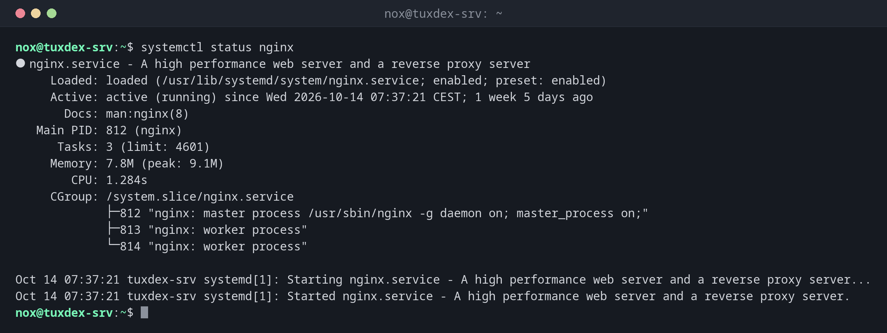

<div align="center">


**The practical handbook for Linux administration and DevOps.**<br>
Every command with syntax, real examples and tips from everyday server work.<br>
In English and German.

[](https://github.com/Noxisan/tuxcodex/actions/workflows/deploy.yml)
[](https://noxisan.github.io/tuxcodex/)
[](LICENSE)


### [📖 Read TuxCodex](https://noxisan.github.io/tuxcodex/)

</div>

---

## What is TuxCodex?

TuxCodex is a reference for everyone who works on Linux servers: one page per command,
built from what you actually need when you are logged in via SSH and something has to
work. It covers Debian, Ubuntu, RHEL (including Rocky and Alma) and Arch, and shows
where they differ.

Every command page has the same structure:

| Section | Contents |
|---------|----------|
| **Syntax & options** | The command at a glance, with the options you really use |
| **Examples** | Practical examples with realistic output from a Debian server |
| **When do I need it?** | Typical situations from server administration |
| **Tips & warnings** | Pitfalls, safer alternatives and things that can go wrong |
| **Distribution differences** | Package names, defaults and commands per distribution |

<div align="center">

</div>

## Chapters

| # | Chapter | Commands | Status |
|---|---------|----------|--------|
| 01 | [Orientation](https://noxisan.github.io/tuxcodex/01-orientation/) | `whoami`, `id`, `hostnamectl`, `uptime`, `last`, … | ✅ 11 |
| 02 | [Navigation](https://noxisan.github.io/tuxcodex/02-navigation/) | `pwd`, `cd`, `ls`, `find`, `locate`, … | ✅ 11 |
| 03 | [Files](https://noxisan.github.io/tuxcodex/03-files/) | `cp`, `mv`, `rm`, `ln`, `stat`, … | ✅ 11 |
| 04 | [Viewing files](https://noxisan.github.io/tuxcodex/04-viewing-files/) | `cat`, `less`, `head`, `tail`, `zless`, … | ✅ 10 |
| 05 | [Text processing](https://noxisan.github.io/tuxcodex/05-text-processing/) | `grep`, `sed`, `awk`, `sort`, `jq`, … | ✅ 13 |
| 06 | [Permissions](https://noxisan.github.io/tuxcodex/06-permissions/) | `chmod`, `chown`, `umask`, `setfacl`, … | ✅ 9 |
| 07 | [Users and groups](https://noxisan.github.io/tuxcodex/07-users-groups/) | `useradd`, `usermod`, `passwd`, `sudo`, … | ✅ 16 |
| 08 | [Processes](https://noxisan.github.io/tuxcodex/08-processes/) | `ps`, `top`, `kill`, `nohup`, `nice`, … | ✅ 19 |
| 09 | [systemd and services](https://noxisan.github.io/tuxcodex/09-systemd/) | `systemctl`, `journalctl`, `shutdown`, … | ✅ 9 |
| 10 | [Packages](https://noxisan.github.io/tuxcodex/10-packages/) | `apt`, `dpkg`, `dnf`, `rpm`, `pacman`, … | ✅ 10 |
| 11 | [Network](https://noxisan.github.io/tuxcodex/11-network/) | `ip`, `ss`, `dig`, `curl`, `ufw`, `tcpdump`, … | ✅ 18 |
| 12 | [SSH](https://noxisan.github.io/tuxcodex/12-ssh/) | `ssh`, `ssh-keygen`, `scp`, `rsync`, `sshd`, … | ✅ 11 |
| 13 | [Disks and storage](https://noxisan.github.io/tuxcodex/13-disks-storage/) | `lsblk`, `df`, `fdisk`, `mount`, `lvextend`, … | ✅ 22 |
| 14 | [Archives](https://noxisan.github.io/tuxcodex/14-archives/) | `tar`, `zip`, `gzip`, `zstd`, `sha256sum`, … | ✅ 8 |
| 15 | Logs | | 🚧 planned |
| 16 | Scheduling | `cron`, `at`, systemd timers | 🚧 planned |
| 17 | Bash scripting | | 🚧 planned |
| 18 | DevOps | Git, Docker, Ansible, CI/CD | 🚧 planned |

## Run it locally

TuxCodex is built with [MkDocs Material](https://squidfunk.github.io/mkdocs-material/)
and [mkdocs-static-i18n](https://github.com/ultrabug/mkdocs-static-i18n).

```bash
git clone https://github.com/Noxisan/tuxcodex.git
cd tuxcodex
python3 -m venv .venv
.venv/bin/pip install -r requirements.txt
.venv/bin/mkdocs serve
```

Then open <http://127.0.0.1:8000>. Every push to `main` is built with
`mkdocs build --strict` and published to GitHub Pages automatically.

## Project structure

```text
docs/
├── index.en.md, index.de.md     # home page
├── 01-orientation/              # one folder per chapter
│   ├── index.en.md              # chapter overview
│   ├── basics.en.md             # background knowledge for the chapter
│   ├── whoami.en.md             # one page per command ...
│   └── whoami.de.md             # ... in English and German
├── assets/screenshots/          # terminal screenshots, one per command
└── stylesheets/, javascripts/   # theme
hooks/command_index.py           # builds the "All commands" list on the home page
scripts/screenshots.py           # renders the terminal screenshots from the examples
```

## Auf Deutsch

TuxCodex gibt es vollständig auf Deutsch: Auf der Seite oben rechts die Sprache
umschalten oder direkt <https://noxisan.github.io/tuxcodex/de/> öffnen.

## License

[MIT](LICENSE)
