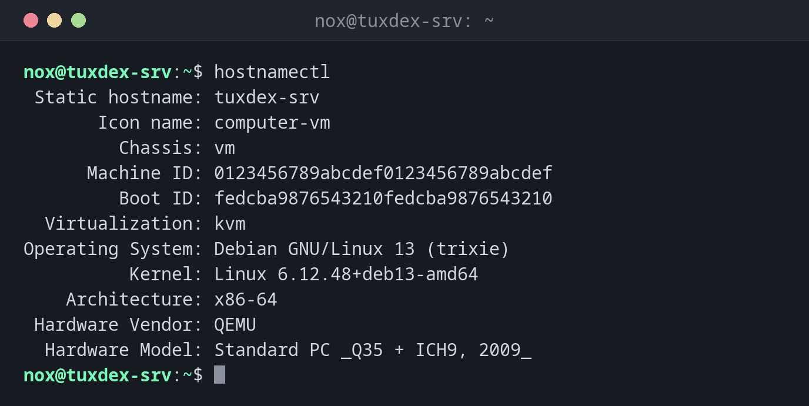

# hostnamectl

> Zeigt den Hostnamen samt grundlegender Systeminformationen an und setzt den Hostnamen dauerhaft.

## Syntax

```bash
hostnamectl [OPTION]... [BEFEHL] [NAME]
```

## Optionen

| Option / Befehl | Beschreibung |
|-----------------|--------------|
| `status` | Hostname und Systeminformationen anzeigen (Standard ohne Befehl) |
| `hostname [NAME]` | Hostnamen anzeigen oder dauerhaft setzen |
| `chassis [NAME]` | Gehäusetyp anzeigen oder setzen (`server`, `vm`, `laptop`, …) |
| `deployment [NAME]` | Einsatzumgebung anzeigen oder setzen (`production`, `staging`, …) |
| `location [NAME]` | Freien Standort-Text anzeigen oder setzen (z. B. Rack oder Rechenzentrum) |
| `--static` | Nur den statischen Hostnamen (`/etc/hostname`) setzen oder anzeigen |
| `--transient` | Nur den flüchtigen Hostnamen (bis zum Neustart) setzen oder anzeigen |
| `--pretty` | Nur den „hübschen“ Hostnamen (freier Text, z. B. `"Webserver 1"`) setzen oder anzeigen |
| `-H`, `--host=[USER@]HOST` | Befehl per SSH auf einem entfernten Host ausführen |
| `--json=FORMAT` | Ausgabe als JSON (`pretty`, `short` oder `off`) |

## Beispiele

**Hostnamen und Systeminformationen anzeigen:**

```bash
hostnamectl
```

```text
 Static hostname: tuxcodex-srv
       Icon name: computer-vm
         Chassis: vm 🖴
      Machine ID: 0123456789abcdef0123456789abcdef
         Boot ID: fedcba9876543210fedcba9876543210
  Virtualization: kvm
Operating System: Debian GNU/Linux 13 (trixie)
          Kernel: Linux 6.12.48+deb13-amd64
    Architecture: x86-64
 Hardware Vendor: QEMU
  Hardware Model: Standard PC _Q35 + ICH9, 2009_
```

**Hostnamen dauerhaft setzen und prüfen:**

```bash
sudo hostnamectl hostname tuxcodex-srv
hostnamectl hostname
```

```text
tuxcodex-srv
```

**Den Server als Produktivsystem kennzeichnen:**

```bash
sudo hostnamectl deployment production
hostnamectl | grep -E 'Static|Deployment'
```

```text
 Static hostname: tuxcodex-srv
      Deployment: production
```



## Wann brauche ich das?

- Um einen frisch installierten Server oder eine geklonte VM umzubenennen, und zwar so, dass der
  Name einen Neustart übersteht
- Um OS-Version, Kernel, Architektur und Virtualisierung auf einen Blick zu sehen, etwa
  wenn du dich zum ersten Mal auf einem fremden Server anmeldest
- Um herauszufinden, ob du auf einer VM, in einem Container oder auf echter Hardware
  bist (`Virtualization`, `Chassis`)
- Um Server mit `deployment` und `location` zu kennzeichnen, denn manche Tools und Prompts
  lesen das aus

!!! tip "Gut zu wissen"
    `hostnamectl hostname NAME` schreibt `/etc/hostname` und ändert gleichzeitig den
    laufenden Hostnamen. Ein Neustart ist nicht nötig, dein Shell-Prompt zeigt den
    neuen Namen aber erst nach einer neuen Anmeldung.

!!! warning "Auch `/etc/hosts` anpassen"
    Unter Debian steht der Hostname zusätzlich in `/etc/hosts` neben `127.0.1.1`.
    Diese Zeile ändert `hostnamectl` nicht. Vergisst du sie, beschwert sich `sudo` mit
    `unable to resolve host`:

    ```text
    127.0.1.1   tuxcodex-srv.example.com tuxcodex-srv
    ```

## Verwandte Befehle

[hostname](hostname.md) · [uname](uname.md) · [timedatectl](timedatectl.md)
