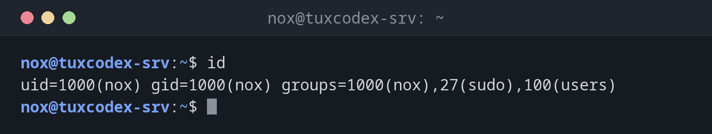

# id

> Shows the user ID, group ID and all group memberships of a user.



## Syntax

```bash
id [OPTION]... [USER]...
```

## Options

| Option | Description |
|--------|-------------|
| `-u`, `--user` | Print only the effective user ID |
| `-g`, `--group` | Print only the effective group ID |
| `-G`, `--groups` | Print all group IDs |
| `-n`, `--name` | Print names instead of numbers (with `-u`, `-g` or `-G`) |
| `-r`, `--real` | Print the real ID instead of the effective one (with `-u`, `-g` or `-G`) |

## Examples

**Show everything about your own user:**

```bash
id
```

```text
uid=1000(nox) gid=1000(nox) groups=1000(nox),27(sudo),100(users)
```

**Check another user, for example the web server user:**

```bash
id www-data
```

```text
uid=33(www-data) gid=33(www-data) groups=33(www-data)
```

**Print only the group names:**

```bash
id -Gn
```

```text
nox sudo users
```

**Print only the numeric user ID (useful in scripts):**

```bash
id -u
```

```text
1000
```

**Check whether a user exists:**

```bash
id backup-user
```

```text
id: ‘backup-user’: no such user
```

## When do I need it?

- To check whether a user is in the `sudo` group (or `docker`, `www-data`, …)
- To find out the UID/GID when files show numbers instead of names, or when setting
  up volumes and NFS shares that need matching IDs
- To check whether a service account exists before you create it
- In scripts: `[ "$(id -u)" -eq 0 ]` is the reliable way to check for root

!!! tip "Good to know"
    `id -un` prints the same as `whoami`. The plain `id` without a user shows the groups
    of your **current session**, while `id nox` reads the group database.

!!! warning "New groups need a new login"
    After `usermod -aG sudo nox`, `id nox` already shows the new group, but plain `id`
    in your open session does not. Log out and back in (or open a new SSH session)
    before the new group membership takes effect.

## Related commands

[whoami](whoami.md)
