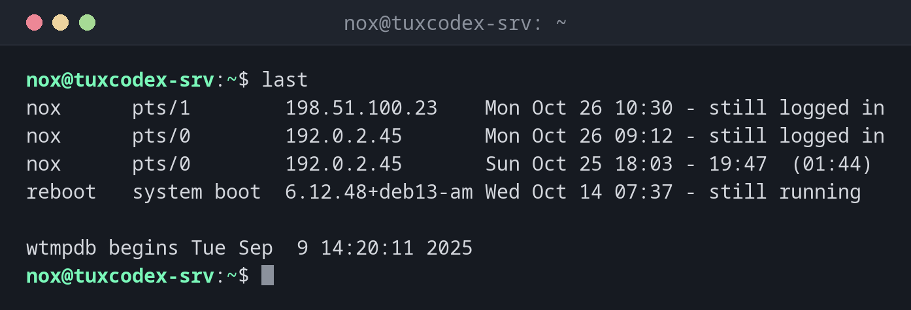

# last

> Shows the login history: who logged in when, from where and for how long, plus reboots.



## Syntax

```bash
last [OPTION]... [USER]...
```

## Options

| Option | Description |
|--------|-------------|
| `-n`, `--limit NUMBER` | Show only the last `NUMBER` entries |
| `-s`, `--since TIME` | Show only entries since `TIME` (e.g. `2026-10-25`) |
| `-t`, `--until TIME` | Show only entries until `TIME` |
| `-p`, `--present TIME` | Show who was logged in at `TIME` |
| `-F`, `--fulltimes` | Print full login and logout times including the year |
| `-i`, `--ip` | Show IP addresses instead of host names |
| `-x`, `--system` | Also show system shutdown entries |
| `-R`, `--nohostname` | Hide the host name column |
| `--time-format FORMAT` | Time format: `notime`, `short`, `full` or `iso` |

## Examples

**Show the login history:**

```bash
last
```

```text
nox      pts/1        198.51.100.23    Mon Oct 26 10:30 - still logged in
nox      pts/0        192.0.2.45       Mon Oct 26 09:12 - still logged in
nox      pts/0        192.0.2.45       Sun Oct 25 18:03 - 19:47  (01:44)
reboot   system boot  6.12.48+deb13-am Wed Oct 14 07:37 - still running

wtmpdb begins Tue Sep  9 14:20:11 2025
```

The newest entries come first. For `reboot`, the third column shows the kernel that
was booted.

**Show only the last 3 entries:**

```bash
last -n 3
```

```text
nox      pts/1        198.51.100.23    Mon Oct 26 10:30 - still logged in
nox      pts/0        192.0.2.45       Mon Oct 26 09:12 - still logged in
nox      pts/0        192.0.2.45       Sun Oct 25 18:03 - 19:47  (01:44)

wtmpdb begins Tue Sep  9 14:20:11 2025
```

**Show the logins of one user only:**

```bash
last nox
```

```text
nox      pts/1        198.51.100.23    Mon Oct 26 10:30 - still logged in
nox      pts/0        192.0.2.45       Mon Oct 26 09:12 - still logged in
nox      pts/0        192.0.2.45       Sun Oct 25 18:03 - 19:47  (01:44)

wtmpdb begins Tue Sep  9 14:20:11 2025
```

**Show only the reboots:**

```bash
last reboot
```

```text
reboot   system boot  6.12.48+deb13-am Wed Oct 14 07:37 - still running
reboot   system boot  6.12.43+deb13-am Thu Oct  1 06:15 - 07:35 (13+01:20)

wtmpdb begins Tue Sep  9 14:20:11 2025
```

## When do I need it?

- After an incident: who was logged in at the time, and from which address?
- To check when the server was last rebooted, and with which kernel
- To spot logins at unusual times or from unknown addresses
- To document maintenance work: when did a colleague log in, and for how long?

!!! tip "Good to know"
    `last` only records **successful** logins. Failed login attempts over SSH can be
    found in the journal: `journalctl -u ssh`.

!!! warning "`last: command not found`"
    On Debian 13 and Ubuntu 25.04 or newer, `last` is no longer part of `util-linux`
    (see below). If the command is missing, install `wtmpdb`. Logins from before the
    installation are not recorded.

## Distribution differences

Debian and newer Ubuntu releases have replaced the old file `/var/log/wtmp`, because its
format can no longer store dates after 2038.

| | Debian | Ubuntu | RHEL | Arch |
|---|--------|--------|------|------|
| Package | `wtmpdb` (install if missing) | `wtmpdb` from 25.04, `util-linux` in 24.04 LTS | `util-linux` | `util-linux` |
| Data file | `/var/log/wtmp.db` | `/var/log/wtmp.db` or `/var/log/wtmp` | `/var/log/wtmp` | `/var/log/wtmp` |
| Last line of the output | `wtmpdb begins …` | depends on the version | `wtmp begins …` | `wtmp begins …` |

Install on Debian and Ubuntu:

```bash
sudo apt install wtmpdb libpam-wtmpdb
```

The options in the table at the top of the page work with both variants.

## Related commands

[who](who.md) · [w](w.md) · [uptime](uptime.md)
