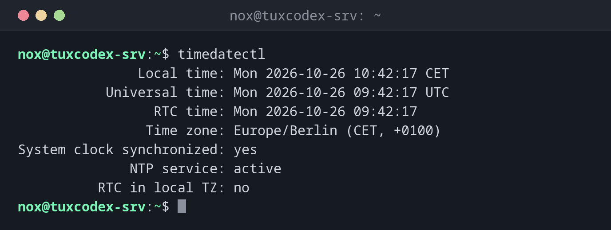

# timedatectl

> Shows and sets the time zone and time synchronization (NTP) of the system.



## Syntax

```bash
timedatectl [OPTION]... [COMMAND]
```

## Options

| Option / command | Description |
|------------------|-------------|
| `status` | Show time, time zone and sync state (default without a command) |
| `set-timezone ZONE` | Set the time zone, e.g. `Europe/Berlin` or `UTC` |
| `list-timezones` | List all available time zones |
| `set-ntp BOOL` | Turn network time synchronization on (`true`) or off (`false`) |
| `timesync-status` | Show details of `systemd-timesyncd` (server, offset, poll interval) |
| `set-time TIME` | Set the time by hand (only possible with NTP turned off) |
| `show` | Show all settings as `key=value` pairs, for scripts |
| `-p`, `--property=NAME` | With `show`: only print the property `NAME` |
| `--value` | With `show`: only print the value, without `NAME=` |

## Examples

**Show time, time zone and sync state:**

```bash
timedatectl
```

```text
               Local time: Mon 2026-10-26 10:42:17 CET
           Universal time: Mon 2026-10-26 09:42:17 UTC
                 RTC time: Mon 2026-10-26 09:42:17
                Time zone: Europe/Berlin (CET, +0100)
System clock synchronized: yes
              NTP service: active
          RTC in local TZ: no
```

**Find a time zone:**

```bash
timedatectl list-timezones | grep Berlin
```

```text
Europe/Berlin
```

**Set the time zone:**

```bash
sudo timedatectl set-timezone Europe/Berlin
timedatectl | grep 'Time zone'
```

```text
                Time zone: Europe/Berlin (CET, +0100)
```

**Turn on time synchronization and check it:**

```bash
sudo timedatectl set-ntp true
timedatectl | grep -E 'synchronized|NTP'
```

```text
System clock synchronized: yes
              NTP service: active
```

**Show details of the time synchronization:**

```bash
timedatectl timesync-status
```

```text
       Server: 192.0.2.123 (0.debian.pool.ntp.org)
Poll interval: 34min 8s (min: 32s; max 34min 8s)
         Leap: normal
      Version: 4
      Stratum: 2
    Reference: C0000201
    Precision: 1us (-25)
Root distance: 23.588ms (max: 5s)
       Offset: -312us
        Delay: 14.207ms
       Jitter: 1.104ms
 Packet count: 42
    Frequency: +3.512ppm
```

**Read only the time zone (for scripts):**

```bash
timedatectl show --property=Timezone --value
```

```text
Europe/Berlin
```

## When do I need it?

- After installing a server: set the right time zone and make sure NTP is active
- When log times look wrong, or entries from two servers don't line up
- When TLS connections, Kerberos or 2FA codes fail, since a wrong clock is a common cause
- To check that time synchronization works (`System clock synchronized: yes`)

!!! tip "UTC on servers"
    Many admins set servers to `UTC` (`sudo timedatectl set-timezone UTC`). Logs from
    servers in different locations can then be compared directly, and there are no
    jumps when daylight saving time starts or ends.

!!! warning "`System clock synchronized: no`"
    If the clock is not synchronized, check `NTP service`. With `inactive`, turn it on
    with `sudo timedatectl set-ntp true`. With `n/a`, no NTP client is installed (see
    below). Also make sure the firewall allows outgoing UDP port 123.

## Debian vs. Arch

| | Debian | Arch |
|---|--------|------|
| NTP client | separate package `systemd-timesyncd` (or `chrony`) | `systemd-timesyncd` is part of `systemd` |
| Enabled | automatically, once installed | no, turn it on with `sudo timedatectl set-ntp true` |

If `timedatectl` shows `NTP service: n/a` on Debian, install the client:

```bash
sudo apt install systemd-timesyncd
```

## Related commands

[date](date.md) · [hostnamectl](hostnamectl.md)
