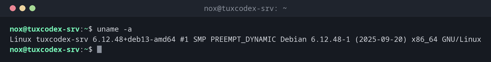

# uname

> Shows information about the running kernel and the hardware architecture.



## Syntax

```bash
uname [OPTION]...
```

## Options

| Option | Description |
|--------|-------------|
| `-a`, `--all` | Print all information |
| `-s`, `--kernel-name` | Print the kernel name (default without options) |
| `-n`, `--nodename` | Print the host name |
| `-r`, `--kernel-release` | Print the kernel release |
| `-v`, `--kernel-version` | Print the kernel build version and date |
| `-m`, `--machine` | Print the hardware architecture |
| `-o`, `--operating-system` | Print the operating system |

## Examples

**Show all information:**

```bash
uname -a
```

```text
Linux tuxcodex-srv 6.12.48+deb13-amd64 #1 SMP PREEMPT_DYNAMIC Debian 6.12.48-1 (2025-09-20) x86_64 GNU/Linux
```

**Show the running kernel release:**

```bash
uname -r
```

```text
6.12.48+deb13-amd64
```

**Show the architecture:**

```bash
uname -m
```

```text
x86_64
```

**Combine options:**

```bash
uname -srm
```

```text
Linux 6.12.48+deb13-amd64 x86_64
```

**Check whether a reboot is needed after a kernel update:**

```bash
uname -r
ls /boot/vmlinuz-*
```

```text
6.12.43+deb13-amd64
/boot/vmlinuz-6.12.43+deb13-amd64
/boot/vmlinuz-6.12.48+deb13-amd64
```

The newest installed kernel (`6.12.48`) is not running yet, so the server needs a reboot.

## When do I need it?

- After a kernel update: if `uname -r` still shows the old version, the server has not
  been rebooted yet
- To pick the right download (`x86_64` vs. `aarch64`), for example for a binary or a
  Docker image
- To install matching kernel headers or modules (DKMS, VirtualBox, WireGuard on older
  systems)
- When filing a bug report or asking for help, where the kernel version is usually the
  first question

!!! tip "Distribution version"
    `uname` only knows the kernel, not the distribution. For the Debian version use
    `cat /etc/os-release` or [`hostnamectl`](hostnamectl.md).

!!! tip "Good to know"
    `-p` (processor) and `-i` (hardware platform) usually only print `unknown` on Linux.
    Use `-m` for the architecture instead.

## Related commands

[hostnamectl](hostnamectl.md) · [hostname](hostname.md)
