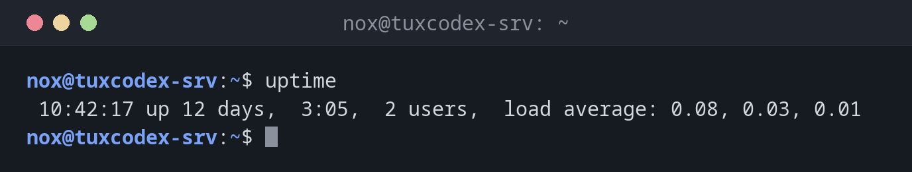

# uptime

> Shows how long the system has been running, how many users are logged in and the load average.

## Syntax

```bash
uptime [OPTION]
```

## Options

| Option | Description |
|--------|-------------|
| `-p`, `--pretty` | Show only the uptime, in a readable format |
| `-s`, `--since` | Show the time the system was booted (`yyyy-mm-dd HH:MM:SS`) |

## Examples

**Show the uptime with time, users and load:**

```bash
uptime
```

```text
 10:42:17 up 12 days,  3:05,  2 users,  load average: 0.08, 0.03, 0.01
```

The output contains: current time, uptime, number of logged-in users and the
load average over the last 1, 5 and 15 minutes.

**Show the uptime in a readable format:**

```bash
uptime -p
```

```text
up 1 week, 5 days, 3 hours, 5 minutes
```

**Show when the system was booted:**

```bash
uptime -s
```

```text
2026-10-14 07:37:05
```

**Put the load in relation to the number of CPU cores:**

```bash
nproc
uptime
```

```text
4
 10:42:17 up 12 days,  3:05,  2 users,  load average: 3.92, 2.10, 1.05
```

With 4 cores, a load of `3.92` means the CPUs are almost fully busy. The load has been
rising over the last 15 minutes (`1.05` → `2.10` → `3.92`).



## When do I need it?

- To check whether a server rebooted unexpectedly (crash, power loss, automatic update)
- As a first quick check when a server feels slow: is the load high, and is it rising
  or falling?
- To confirm that a planned reboot actually happened
- In monitoring scripts that only need the boot time (`uptime -s`)

!!! tip "Reading the load average"
    The load average counts processes that are running or waiting for CPU or disk I/O.
    As a rule of thumb, a load above the number of CPU cores (`nproc`) means work is
    queuing up. The three values show the trend: if the 1-minute value is higher than
    the 15-minute value, the load is rising.

!!! warning "High load is not always CPU"
    On Linux, processes waiting for disk or network storage (state `D`) also count
    towards the load. A high load with an idle CPU often points to slow storage.

## Related commands

[w](w.md) · [uname](uname.md)
