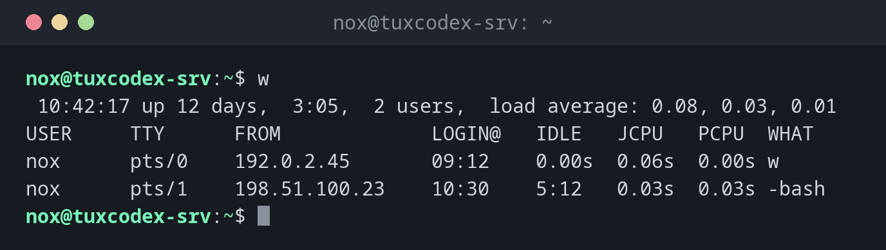

# w

> Shows who is logged in and what they are currently doing, plus uptime and load.



## Syntax

```bash
w [OPTION]... [USER]
```

## Options

| Option | Description |
|--------|-------------|
| `-h`, `--no-header` | Don't print the header line (time, uptime, load) |
| `-s`, `--short` | Short format without login time, JCPU and PCPU |
| `-f`, `--from` | Toggle the `FROM` column (remote host) on or off |
| `-i`, `--ip-addr` | Show IP addresses instead of host names in `FROM` |
| `-p`, `--pids` | Show the PID of the process in `WHAT` |
| `-o`, `--old-style` | Old output format: blank idle time under one minute |
| `USER` | Show only the sessions of this user |

## Examples

**Show all sessions:**

```bash
w
```

```text
 10:42:17 up 12 days,  3:05,  2 users,  load average: 0.08, 0.03, 0.01
USER     TTY      FROM             LOGIN@   IDLE   JCPU   PCPU  WHAT
nox      pts/0    192.0.2.10       09:12    0.00s  0.06s  0.00s w
nox      pts/1    198.51.100.23    10:30    5:12   0.03s  0.03s -bash
```

The first line is the same as [`uptime`](uptime.md). Below it you see one line per session:

| Column | Meaning |
|--------|---------|
| `USER` | Logged-in user |
| `TTY` | Terminal of the session |
| `FROM` | Remote address of the login |
| `LOGIN@` | Login time |
| `IDLE` | Time since the last input |
| `JCPU` | CPU time of all processes on this terminal |
| `PCPU` | CPU time of the current process (`WHAT`) |
| `WHAT` | Currently running command |

**Show only the session list without the header:**

```bash
w -h
```

```text
nox      pts/0    192.0.2.10       09:12    0.00s  0.06s  0.00s w -h
nox      pts/1    198.51.100.23    10:30    5:12   0.03s  0.03s -bash
```

**Short format:**

```bash
w -s
```

```text
 10:42:17 up 12 days,  3:05,  2 users,  load average: 0.08, 0.03, 0.01
USER     TTY      FROM              IDLE WHAT
nox      pts/0    192.0.2.10        0.00s w -s
nox      pts/1    198.51.100.23     5:12  -bash
```

**Show only the sessions of one user:**

```bash
w nox
```

```text
 10:42:17 up 12 days,  3:05,  2 users,  load average: 0.08, 0.03, 0.01
USER     TTY      FROM             LOGIN@   IDLE   JCPU   PCPU  WHAT
nox      pts/0    192.0.2.10       09:12    0.00s  0.06s  0.00s w nox
nox      pts/1    198.51.100.23    10:30    5:12   0.03s  0.03s -bash
```

## When do I need it?

- Before a reboot: is someone still working, or is a session just idle for hours?
- To see what other admins are doing right now, for example if someone is running an
  `apt upgrade` at the same time as you
- To find forgotten sessions with a long `IDLE` time
- As a quick overview after login: uptime, load and active users in one command

!!! tip "`w` vs. `who`"
    [`who`](who.md) only shows **who** is logged in. `w` also shows **what** they are
    doing and how long they have been idle, plus the uptime and load.

!!! warning "Check before you reboot"
    A session running `apt`, `dpkg` or a database migration must not be interrupted by
    a reboot. Look at the `WHAT` column first.

## Related commands

[who](who.md) · [last](last.md) · [uptime](uptime.md)
