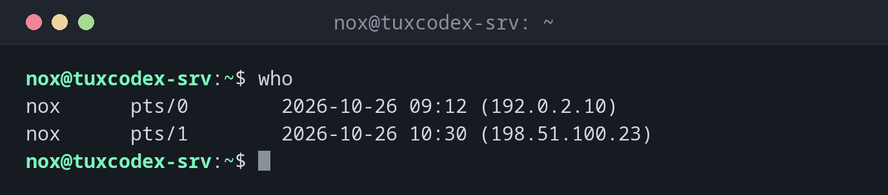

# who

> Zeigt, wer gerade am System angemeldet ist, an welchem Terminal und von wo.



## Syntax

```bash
who [OPTION]... [DATEI | am i]
```

## Optionen

| Option | Beschreibung |
|--------|--------------|
| `-H`, `--heading` | Eine Zeile mit Spaltenüberschriften ausgeben |
| `-b`, `--boot` | Zeitpunkt des letzten Systemstarts ausgeben |
| `-u`, `--users` | Zusätzlich Leerlaufzeit und PID jeder Anmeldung ausgeben |
| `-q`, `--count` | Nur die Anmeldenamen und die Anzahl der angemeldeten Benutzer ausgeben |
| `-m` | Nur die eigene Sitzung ausgeben (wie `who am i`) |
| `-r`, `--runlevel` | Aktuellen Runlevel ausgeben |
| `-a`, `--all` | Alle Informationen ausgeben (wie `-b -d --login -p -r -t -T -u`) |

## Beispiele

**Anzeigen, wer angemeldet ist:**

```bash
who
```

```text
nox      pts/0        2026-10-26 09:12 (192.0.2.10)
nox      pts/1        2026-10-26 10:30 (198.51.100.23)
```

`pts/0` und `pts/1` sind Pseudo-Terminals, meist SSH-Sitzungen. Die Adresse in Klammern
zeigt, von wo die Anmeldung kam.

**Dieselbe Liste mit Spaltenüberschriften:**

```bash
who -H
```

```text
NAME     LINE         TIME             COMMENT
nox      pts/0        2026-10-26 09:12 (192.0.2.10)
nox      pts/1        2026-10-26 10:30 (198.51.100.23)
```

**Nur die eigene Sitzung anzeigen:**

```bash
who am i
```

```text
nox      pts/0        2026-10-26 09:12 (192.0.2.10)
```

**Die angemeldeten Benutzer zählen:**

```bash
who -q
```

```text
nox nox
# users=2
```

**Den Zeitpunkt des letzten Starts anzeigen:**

```bash
who -b
```

```text
         system boot  2026-10-14 07:37
```

## Wann brauche ich das?

- Vor einem Neustart oder einer Wartung: Arbeitet gerade noch jemand auf dem Server?
- Um ungewöhnliche Anmeldungen zu entdecken, etwa von einer unbekannten IP-Adresse
- Um herauszufinden, von welcher Adresse du selbst verbunden bist (`who am i`), zum
  Beispiel für eine Firewall-Regel
- Um das Terminal (`pts/1`) einer anderen Sitzung zu finden, bevor du ihr mit `write`
  eine Nachricht schickst oder sie beendest

!!! tip "Gut zu wissen"
    `who am i` zeigt den Benutzer, der sich am Terminal **angemeldet** hat, auch nach
    `sudo -i` oder `su`. [`whoami`](whoami.md) zeigt dagegen, als wer du gerade arbeitest.

!!! warning "Unbekannte Anmeldungen"
    Zeigt `who` eine Sitzung von einer Adresse, die du nicht kennst, prüfe sie sofort mit
    [`w`](w.md) (was macht sie gerade?) und in den SSH-Logs. Notiere Benutzer, Terminal, Adresse
    und Uhrzeit, bevor du die Sitzung beendest. So kannst du später nachforschen.

## Verwandte Befehle

[w](w.md) · [last](last.md) · [whoami](whoami.md)
