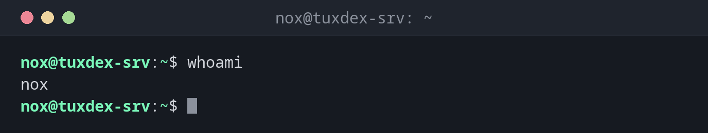

# whoami

> Zeigt den Namen des Benutzers an, als der du gerade arbeitest (den effektiven Benutzer).

## Syntax

```bash
whoami [OPTION]
```

## Optionen

`whoami` hat keine eigenen Optionen – es macht genau eine Sache.

| Option      | Beschreibung                              |
|-------------|-------------------------------------------|
| `--help`    | Hilfetext anzeigen und beenden            |
| `--version` | Versionsinformationen anzeigen und beenden |

## Beispiele

**Den eigenen Benutzernamen prüfen:**

```bash
whoami
```

```text
nox
```

**Prüfen, als welcher Benutzer ein Befehl mit `sudo` läuft:**

```bash
sudo whoami
```

```text
root
```

**Nach einem Benutzerwechsel nachsehen, wo du gelandet bist:**

```bash
sudo -i
whoami
```

```text
root
```

**Ein Skript so absichern, dass es nicht als root läuft:**

```bash
if [ "$(whoami)" = "root" ]; then
    echo "Please do not run this script as root." >&2
    exit 1
fi
```

```text
Please do not run this script as root.
```



## Wann brauche ich das?

- Nach `su`, `sudo -i` oder `sudo -u <benutzer> -s`, um sicherzugehen, dass du wirklich als der Benutzer arbeitest, den du erwartest
- Bevor du etwas Zerstörerisches ausführst (`rm -rf`, `chown -R`, `systemctl stop`): ein kurzes `whoami` erspart böse Überraschungen
- In Skripten, die als bestimmter Benutzer laufen müssen – oder gerade nicht
- Wenn mehrere SSH-Sitzungen offen sind und du den Überblick verloren hast

!!! tip "Gut zu wissen"
    `whoami` zeigt den **effektiven** Benutzer – deshalb gibt `sudo whoami` `root` aus.
    Der Befehl entspricht `id -un`.

!!! warning "`whoami` ist nicht `who am i`"
    `who am i` (mit Leerzeichen) ist ein anderer Befehl: Er zeigt, wer sich am aktuellen
    Terminal **angemeldet** hat, samt Anmeldezeit und Herkunft. Nach `sudo -i` liefert
    `whoami` also `root`, `who am i` dagegen weiterhin `nox`.

## Verwandte Befehle

[id](id.md) · [hostname](hostname.md)
