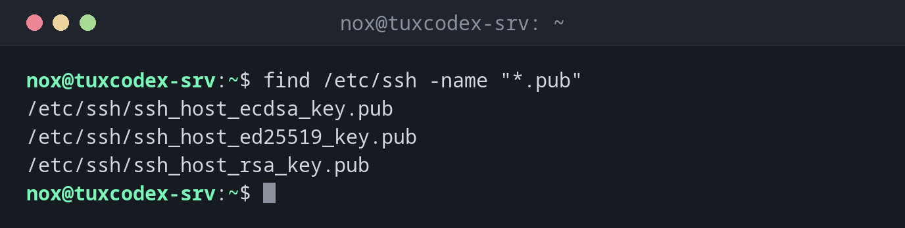

# find

> Searches a directory tree for files by name, type, size, age, owner or permissions, and can run commands on the results.



## Syntax

```bash
find [DIRECTORY]... [TEST]... [ACTION]
```

## Options

| Test / action | Description |
|---------------|-------------|
| `-name PATTERN` | Name matches `PATTERN` (e.g. `"*.log"`), case-sensitive |
| `-iname PATTERN` | Like `-name`, but ignores upper and lower case |
| `-type TYPE` | `f` file, `d` directory, `l` symbolic link |
| `-size N` | Size: `+500M` larger than 500 MB, `-10k` smaller than 10 KB |
| `-mtime N` | Last changed `N` days ago: `+14` older than 14 days, `-1` within the last day |
| `-mmin N` | Like `-mtime`, but in minutes |
| `-user NAME` | Belongs to user `NAME` |
| `-perm MODE` | Has the permissions `MODE` (e.g. `-perm 777`) |
| `-empty` | Empty file or directory |
| `-maxdepth N` | Search at most `N` levels deep |
| `-xdev` | Stay on the current file system (don't descend into `/proc`, mounts, …) |
| `-exec CMD {} +` | Run `CMD` with the found files as arguments |
| `-delete` | Delete the found files |

## Examples

**Find files by name:**

```bash
find /etc/ssh -name "*.pub"
```

```text
/etc/ssh/ssh_host_ecdsa_key.pub
/etc/ssh/ssh_host_ed25519_key.pub
/etc/ssh/ssh_host_rsa_key.pub
```

**Find only directories:**

```bash
find ~ -type d
```

```text
/home/nox
/home/nox/backup
/home/nox/scripts
```

**Find large files when the disk is full:**

```bash
find / -xdev -type f -size +500M 2>/dev/null
```

```text
/home/nox/backup/db-2026-10-20.sql.gz
```

**Find old files:**

```bash
find /var/log/apt -name "*.gz" -mtime +14
```

```text
/var/log/apt/history.log.1.gz
/var/log/apt/term.log.1.gz
```

**Find configuration files changed in the last hour:**

```bash
sudo find /etc -type f -mmin -60
```

```text
/etc/nginx/sites-available/example.com
```

**Run a command on all matches:**

```bash
find ~/scripts -name "*.sh" -exec chmod 750 {} +
ls -l ~/scripts
```

```text
total 8
-rwxr-x--- 1 nox nox 1200 Oct 22 18:40 backup.sh
-rwxr-x--- 1 nox nox  640 Oct 22 18:35 cleanup.sh
```

## When do I need it?

- When the disk is full: find large files with `-size`
- To clean up old logs, backups or temporary files (`-mtime` together with `-delete`)
- To find out which configuration files were changed recently (`-mmin`, `-newer`)
- To fix owner or permissions for many files at once (`-exec chown` / `-exec chmod`)
- When you know a file name, but not where the file is

!!! tip "Hide \"Permission denied\" messages"
    As a normal user, `find /` prints an error for every directory you are not allowed
    to read. Add `2>/dev/null` to hide these messages, or run the search with `sudo`.

!!! warning "Always quote patterns"
    Write `-name "*.log"`, not `-name *.log`. Without quotes, the shell expands `*.log`
    in the current directory before `find` even starts, and the search gives wrong results.

!!! danger "Test before you delete"
    Run the search without `-delete` first and check the list. Put `-delete` always at
    the **end**: `find . -delete -name "*.tmp"` deletes **everything** in the current
    directory, because `-delete` runs before the name test.

    ```bash
    find /tmp -type f -name "*.tmp" -mtime +7          # check the list first
    find /tmp -type f -name "*.tmp" -mtime +7 -delete  # then delete
    ```

## Related commands

[ls](ls.md) · [tree](tree.md) · [locate](locate.md)
