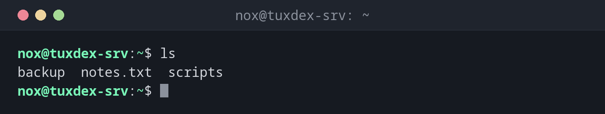

# ls

> Listet den Inhalt eines Verzeichnisses auf, auf Wunsch mit Rechten, Besitzer, Größe und Datum.



## Syntax

```bash
ls [OPTION]... [DATEI]...
```

## Optionen

| Option | Beschreibung |
|--------|--------------|
| `-l` | Langes Format: Rechte, Besitzer, Gruppe, Größe und Datum |
| `-a`, `--all` | Auch versteckte Dateien (beginnen mit `.`) zeigen, inklusive `.` und `..` |
| `-A`, `--almost-all` | Versteckte Dateien zeigen, aber ohne `.` und `..` |
| `-h`, `--human-readable` | Größen in K, M, G statt in Bytes (zusammen mit `-l`) |
| `-t` | Nach Änderungszeit sortieren, neueste zuerst |
| `-r`, `--reverse` | Sortierung umkehren |
| `-S` | Nach Größe sortieren, größte zuerst |
| `-R`, `--recursive` | Auch alle Unterverzeichnisse auflisten |
| `-d`, `--directory` | Das Verzeichnis selbst zeigen, nicht seinen Inhalt |
| `-1` | Ein Eintrag pro Zeile |
| `-F`, `--classify` | Typ markieren: `/` Verzeichnis, `*` ausführbar, `@` Link |
| `-i`, `--inode` | Inode-Nummer anzeigen |
| `--group-directories-first` | Verzeichnisse vor Dateien anzeigen |

## Beispiele

**Das aktuelle Verzeichnis auflisten:**

```bash
ls
```

```text
backup  notes.txt  scripts
```

**Details im langen Format anzeigen:**

```bash
ls -l
```

```text
total 12
drwxr-xr-x 2 nox nox 4096 Oct 20 14:03 backup
-rw-r--r-- 1 nox nox  812 Oct 26 09:15 notes.txt
drwxr-xr-x 2 nox nox 4096 Oct 22 18:40 scripts
```

| Spalte | Bedeutung |
|--------|-----------|
| `drwxr-xr-x` | Typ (`d` Verzeichnis, `-` Datei, `l` Link) und Rechte |
| `2` | Anzahl der harten Links |
| `nox nox` | Besitzer und Gruppe |
| `4096` | Größe in Bytes |
| `Oct 20 14:03` | Zeitpunkt der letzten Änderung |
| `backup` | Name |

**Auch versteckte Dateien zeigen:**

```bash
ls -la
```

```text
total 36
drwx------ 4 nox  nox  4096 Oct 26 09:15 .
drwxr-xr-x 3 root root 4096 Sep  9 14:25 ..
-rw------- 1 nox  nox  1843 Oct 26 10:40 .bash_history
-rw-r--r-- 1 nox  nox   220 Sep  9 14:25 .bash_logout
-rw-r--r-- 1 nox  nox  3526 Sep  9 14:25 .bashrc
-rw-r--r-- 1 nox  nox   807 Sep  9 14:25 .profile
drwxr-xr-x 2 nox  nox  4096 Oct 20 14:03 backup
-rw-r--r-- 1 nox  nox   812 Oct 26 09:15 notes.txt
drwxr-xr-x 2 nox  nox  4096 Oct 22 18:40 scripts
```

**Größen gut lesbar anzeigen:**

```bash
ls -lh backup
```

```text
total 1.3G
-rw-r--r-- 1 nox nox 1.2G Oct 20 14:03 db-2026-10-20.sql.gz
-rw-r--r-- 1 nox nox  98M Oct 20 14:01 etc-2026-10-20.tar.gz
```

**Nach Zeit sortieren, neueste unten (praktisch für Logs):**

```bash
ls -ltr /var/log/nginx/access*
```

```text
-rw-r----- 1 www-data adm  3518 Oct 24 23:59 /var/log/nginx/access.log.2.gz
-rw-r----- 1 www-data adm 12873 Oct 25 23:59 /var/log/nginx/access.log.1
-rw-r----- 1 www-data adm  4102 Oct 26 10:41 /var/log/nginx/access.log
```

**Nur Verzeichnisse anzeigen:**

```bash
ls -d */
```

```text
backup/  scripts/
```

**Die Rechte eines Verzeichnisses selbst anzeigen:**

```bash
ls -ld /etc
```

```text
drwxr-xr-x 79 root root 4096 Oct 26 08:01 /etc
```

## Wann brauche ich das?

- Ständig: um zu sehen, was in einem Verzeichnis liegt, bevor du damit arbeitest
- Um Besitzer und Rechte zu prüfen, wenn ein Dienst eine Datei nicht lesen kann (`ls -l`)
- Um die neueste Logdatei oder das jüngste Backup zu finden (`ls -ltr`)
- Um große Dateien in einem Verzeichnis zu finden (`ls -lhS`)
- Um versteckte Konfigurationsdateien wie `.htaccess` oder `.env` zu entdecken (`ls -la`)

!!! tip "Abkürzungen mit Aliasen"
    Ubuntu (`ll` = `ls -alF`) und RHEL (`ll` = `ls -l`) haben schon einen Alias `ll`.
    Unter Debian sind die Aliase in `~/.bashrc` auskommentiert: Entferne das `#` vor
    `alias ll='ls -l'` und öffne eine neue Shell, um sie zu nutzen.

!!! warning "Die Ausgabe von `ls` nicht in Skripten verwenden"
    Dateinamen können Leerzeichen und Sonderzeichen enthalten, die die Ausgabe von `ls`
    unbrauchbar machen. Nimm in Skripten stattdessen `for f in /pfad/*` oder [`find`](find.md).

## Verwandte Befehle

[cd](cd.md) · [pwd](pwd.md) · [tree](tree.md) · [find](find.md)
