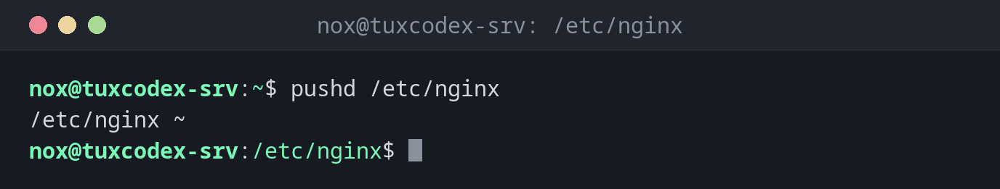

# pushd

> Wechselt in ein Verzeichnis und merkt sich das bisherige auf einem Stapel, damit du später zurückspringen kannst.

## Syntax

```bash
pushd [-n] [VERZEICHNIS | +N | -N]
```

## Optionen

| Option / Argument | Beschreibung |
|-------------------|--------------|
| `VERZEICHNIS` | `VERZEICHNIS` oben auf den Stapel legen und hineinwechseln |
| *(keins)* | Die beiden obersten Einträge tauschen und ins neue oberste wechseln |
| `+N` | Stapel so drehen, dass Eintrag `N` (von links gezählt, ab 0) oben liegt |
| `-N` | Wie `+N`, aber von rechts gezählt |
| `-n` | Nur den Stapel ändern, nicht das Verzeichnis wechseln |

Den Stapel zeigt `dirs`: `dirs -v` nummeriert die Einträge, `dirs -c` leert den Stapel.

## Beispiele

**In ein Verzeichnis wechseln und sich die Herkunft merken:**

```bash
pushd /etc/nginx
```

```text
/etc/nginx ~
```

Die Ausgabe ist der Stapel: links das aktuelle Verzeichnis, rechts daneben die gemerkten.

**Ein weiteres Verzeichnis hinzufügen:**

```bash
pushd /var/log/nginx
```

```text
/var/log/nginx /etc/nginx ~
```

**Den Stapel mit Nummern anzeigen:**

```bash
dirs -v
```

```text
 0  /var/log/nginx
 1  /etc/nginx
 2  ~
```

**Zwischen den beiden obersten Verzeichnissen wechseln:**

```bash
pushd
```

```text
/etc/nginx /var/log/nginx ~
```

**Zu einem bestimmten Eintrag des Stapels springen:**

```bash
pushd +2
```

```text
~ /etc/nginx /var/log/nginx
```

**Ein Verzeichnis auf den Stapel legen, ohne hineinzuwechseln:**

```bash
pushd -n /tmp
```

```text
~ /tmp /etc/nginx /var/log/nginx
```



## Wann brauche ich das?

- Wenn du an mehreren Stellen gleichzeitig arbeitest, etwa eine Konfiguration in
  `/etc/nginx` bearbeitest und das Ergebnis in `/var/log/nginx` prüfst
- In Skripten, die kurz in einem anderen Verzeichnis arbeiten und danach an den
  Ausgangspunkt zurückkehren (zusammen mit `popd`)
- Wenn `cd -` nicht reicht, weil du mehr als zwei Verzeichnisse brauchst

!!! tip "`pushd` ohne Argumente"
    `pushd` allein tauscht die beiden obersten Verzeichnisse. Das funktioniert wie
    `cd -`, aber die übrigen gemerkten Verzeichnisse bleiben auf dem Stapel.

!!! warning "Der Stapel lebt nur in der aktuellen Shell"
    Der Verzeichnisstapel geht verloren, wenn du die Shell oder die SSH-Sitzung schließt.
    Jede Shell und jedes Skript hat einen eigenen Stapel.

## Verwandte Befehle

[cd](cd.md) · [pwd](pwd.md)
