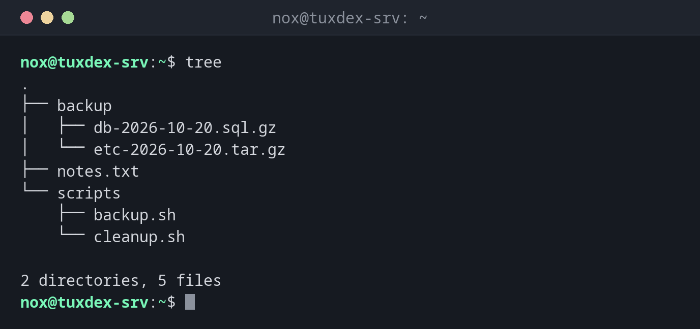

# tree

> Zeigt den Inhalt eines Verzeichnisses und aller Unterverzeichnisse als Baum.

## Syntax

```bash
tree [OPTION]... [VERZEICHNIS]...
```

## Optionen

| Option | Beschreibung |
|--------|--------------|
| `-L EBENE` | Nur `EBENE` Ebenen tief anzeigen |
| `-d` | Nur Verzeichnisse anzeigen |
| `-a` | Auch versteckte Dateien anzeigen |
| `-I MUSTER` | Dateien ausblenden, die auf `MUSTER` passen (z. B. `'*.gz'`) |
| `-P MUSTER` | Nur Dateien anzeigen, die auf `MUSTER` passen |
| `-f` | Vollständigen Pfad jedes Eintrags anzeigen |
| `-h` | Dateigrößen in K, M, G anzeigen |
| `-p` | Rechte wie bei `ls -l` anzeigen |
| `-u` | Besitzer anzeigen |
| `--dirsfirst` | Verzeichnisse vor Dateien anzeigen |
| `--du` | Gesamtgröße jedes Verzeichnisses anzeigen |

## Beispiele

**Das aktuelle Verzeichnis als Baum anzeigen:**

```bash
tree
```

```text
.
├── backup
│   ├── db-2026-10-20.sql.gz
│   └── etc-2026-10-20.tar.gz
├── notes.txt
└── scripts
    ├── backup.sh
    └── cleanup.sh

2 directories, 5 files
```

**Nur die erste Ebene anzeigen:**

```bash
tree -L 1
```

```text
.
├── backup
├── notes.txt
└── scripts

2 directories, 1 file
```

**Nur Verzeichnisse anzeigen:**

```bash
tree -d
```

```text
.
├── backup
└── scripts

2 directories
```

**Auch versteckte Dateien anzeigen:**

```bash
tree -a -L 1
```

```text
.
├── .bash_history
├── .bash_logout
├── .bashrc
├── .profile
├── backup
├── notes.txt
└── scripts

2 directories, 5 files
```

**Bestimmte Dateien ausblenden:**

```bash
tree -I '*.gz'
```

```text
.
├── backup
├── notes.txt
└── scripts
    ├── backup.sh
    └── cleanup.sh

2 directories, 3 files
```



## Wann brauche ich das?

- Um sich einen Überblick über ein unbekanntes Verzeichnis zu verschaffen, etwa ein
  Webprojekt in `/var/www` oder ein Konfigurationsverzeichnis wie `/etc/nginx`
- Um die Struktur eines Projekts oder Backups in einer README oder einem Ticket zu
  dokumentieren
- Um schnell zu prüfen, ob ein Deployment alle Dateien an die richtige Stelle gelegt hat

!!! tip "Bei großen Verzeichnissen immer die Tiefe begrenzen"
    `tree /` oder `tree /usr` gibt Hunderttausende Zeilen aus. Mit `-L 2` oder `-d`
    bleibt die Ausgabe lesbar.

!!! warning "Nicht standardmäßig installiert"
    `tree` gehört nicht zu einer minimalen Debian-Installation. Installiere es mit:

    ```bash
    sudo apt install tree
    ```

## Verwandte Befehle

[ls](ls.md) · [cd](cd.md) · [find](find.md)
