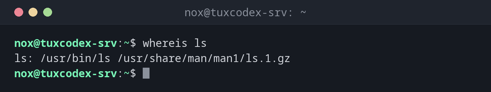

# whereis

> Findet Programmdatei, Konfiguration und Manpages eines Befehls in den Standardverzeichnissen des Systems.

## Syntax

```bash
whereis [OPTION]... NAME...
```

## Optionen

| Option | Beschreibung |
|--------|--------------|
| `-b` | Nur nach Programmdateien (Binaries) suchen |
| `-m` | Nur nach Manpages suchen |
| `-s` | Nur nach Quelldateien suchen |
| `-u` | Nur Namen mit ungewöhnlichen Einträgen zeigen (fehlende oder mehrfache Treffer) |
| `-B VERZ... -f` | Programme nur in den angegebenen Verzeichnissen suchen |
| `-M VERZ... -f` | Manpages nur in den angegebenen Verzeichnissen suchen |
| `-l` | Verzeichnisse anzeigen, die `whereis` durchsucht |

## Beispiele

**Programm und Manpage eines Befehls finden:**

```bash
whereis ls
```

```text
ls: /usr/bin/ls /usr/share/man/man1/ls.1.gz
```

**Alles finden, was zu einem Dienst gehört:**

```bash
whereis nginx
```

```text
nginx: /usr/sbin/nginx /usr/lib/nginx /etc/nginx /usr/share/nginx /usr/share/man/man8/nginx.8.gz
```

**Nur Programmdateien und Verzeichnisse anzeigen:**

```bash
whereis -b ssh
```

```text
ssh: /usr/bin/ssh /etc/ssh
```

**Nur die Manpage anzeigen:**

```bash
whereis -m ssh
```

```text
ssh: /usr/share/man/man1/ssh.1.gz
```

**Ein Programm, das nicht installiert ist:**

```bash
whereis nmap
```

```text
nmap:
```



## Wann brauche ich das?

- Um das Konfigurationsverzeichnis eines Dienstes schnell zu finden (`/etc/nginx`, `/etc/ssh`)
- Um zu prüfen, ob ein Programm und seine Manpage installiert sind
- Um Admin-Programme in `/usr/sbin` zu finden, die [`which`](which.md) als normaler
  Benutzer nicht findet

!!! tip "`whereis` oder `which`?"
    `which` sucht nur in deinem `$PATH` und zeigt das Programm, das wirklich ausgeführt
    wird. `whereis` durchsucht eine feste Liste von Systemverzeichnissen (`/usr/bin`,
    `/usr/sbin`, `/etc`, `/usr/share/man` …) und findet auch Manpages und Konfiguration.

!!! warning "Nur Standardverzeichnisse"
    Programme an ungewöhnlichen Orten wie `/opt/app/bin` findet `whereis` nicht. Dafür
    nimmst du [`locate`](locate.md) oder [`find`](find.md).

## Verwandte Befehle

[which](which.md) · [locate](locate.md)
