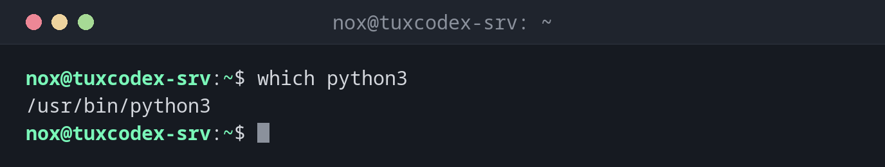

# which

> Shows which program file is run when you type a command.

## Syntax

```bash
which [-as] COMMAND...
```

## Options

| Option | Description |
|--------|-------------|
| `-a` | Show all matching programs in `$PATH`, not only the first one |
| `-s` | Print nothing, only return the exit status (`0` found, `1` not found) |

## Examples

**Find out where a program is located:**

```bash
which python3
```

```text
/usr/bin/python3
```

**Show all matches in the search path:**

```bash
which -a ls
```

```text
/usr/bin/ls
/bin/ls
```

On Debian, `/bin` is a link to `/usr/bin`, and both are in `$PATH`. That's why the same
program is listed twice.

**Check several commands at once:**

```bash
which git curl rsync
```

```text
/usr/bin/git
/usr/bin/curl
/usr/bin/rsync
```

**A command that is not installed:**

```bash
which nmap
echo $?
```

```text
1
```

**Find out what a command really is (with `type`):**

```bash
which cd
type cd
type ls
```

```text
cd is a shell builtin
ls is aliased to `ls --color=auto'
```

`which` only searches for program files. `cd` is built into the shell, so `which` finds
nothing. The shell builtin `type` also knows builtins, aliases and functions.



## When do I need it?

- To check whether a program is installed and in your `$PATH`
- When several versions are installed (e.g. in `/usr/local/bin` and `/usr/bin`) and you
  want to know which one runs
- To get the full path for a cron job, a systemd unit or a `sudoers` rule, where you
  should always use absolute paths

!!! tip "In scripts: `command -v`"
    To check in a script whether a program exists, use the shell builtin `command -v`.
    It works the same way on every system:

    ```bash
    if command -v docker > /dev/null; then echo "Docker is installed"; fi
    ```

!!! warning "Commands in `/usr/sbin`"
    `which` only searches the directories in your `$PATH`. Admin programs like `nginx`
    or `sshd` are in `/usr/sbin`, which is not always in the `$PATH` of normal users.
    `which` then finds nothing, although the program is installed.

## Debian vs. Arch

| | Debian | Arch |
|---|--------|------|
| Program | `which` from `debianutils` | GNU `which` (package `which`) |
| Options | only `-a` and `-s` | many more, e.g. `--skip-alias`, `--read-functions` |
| Not found | no output, exit status `1` | message `which: no nmap in (...)` |

## Related commands

[find](find.md) · [locate](locate.md)
