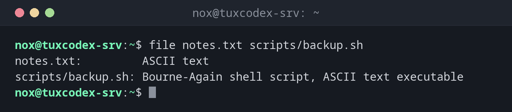

# file

> Detects the type of a file from its content, no matter what the file name or extension says.



## Syntax

```bash
file [OPTION]... FILE...
```

## Options

| Option | Description |
|--------|-------------|
| `-b`, `--brief` | Only print the type, without the file name |
| `-i`, `--mime` | Print the MIME type and character set (e.g. `text/plain; charset=utf-8`) |
| `-L`, `--dereference` | Follow symbolic links and check the target |
| `-z`, `--uncompress` | Look inside compressed files |
| `-s`, `--special-files` | Also read block devices and partitions (e.g. `/dev/vda1`) |

## Examples

**Check the type of several files:**

```bash
file notes.txt scripts/backup.sh
```

```text
notes.txt:         ASCII text
scripts/backup.sh: Bourne-Again shell script, ASCII text executable
```

**Check what is in a backup:**

```bash
file backup/*
```

```text
backup/db-2026-10-20.sql.gz:  gzip compressed data, was "db-2026-10-20.sql", last modified: Tue Oct 20 12:00:12 2026, from Unix, original size modulo 2^32 1073741824
backup/etc-2026-10-20.tar.gz: gzip compressed data, from Unix, original size modulo 2^32 432013312
```

**Find a script with Windows line endings:**

```bash
file deploy.sh
```

```text
deploy.sh: Bourne-Again shell script, ASCII text executable, with CRLF line terminators
```

**Find out what a symbolic link points to:**

```bash
file /bin/sh
file -L /bin/sh
```

```text
/bin/sh: symbolic link to dash
/bin/sh: ELF 64-bit LSB pie executable, x86-64, version 1 (SYSV), dynamically linked, interpreter /lib64/ld-linux-x86-64.so.2, BuildID[sha1]=4f6c1a2e9b3d8c7f5e0a1b2c3d4e5f6a7b8c9d0e, for GNU/Linux 3.2.0, stripped
```

**Detect a file with the wrong extension:**

```bash
file logo.txt
```

```text
logo.txt: PNG image data, 1254 x 1254, 8-bit/color RGB, non-interlaced
```

**Show the MIME type and character set:**

```bash
file -i notes.txt
```

```text
notes.txt: text/plain; charset=us-ascii
```

## When do I need it?

- When a script fails with `/bin/bash^M: bad interpreter`: `file` shows
  `with CRLF line terminators`, the file was saved on Windows
- To check uploads or downloads whose name or extension you don't trust
- To find out whether a file is text or binary before opening it with an editor
- To check backups and archives before restoring them

!!! tip "Fix Windows line endings"
    Convert a file with CRLF line endings to Linux format with
    `sed -i 's/\r$//' deploy.sh`. The package `dos2unix` offers the same as a separate
    command.

!!! warning "Not a security check"
    `file` only looks at the first bytes of a file and uses known patterns. It is useful
    for orientation, but not proof that an uploaded file is harmless.

## Related commands

[stat](stat.md) · [ln](ln.md)
