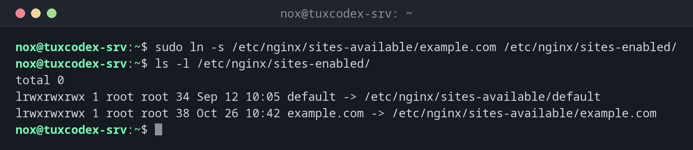

# ln

> Creates links: symbolic links point to a path, hard links are a second name for the same file.



## Syntax

```bash
ln [OPTION]... TARGET LINK_NAME
ln [OPTION]... TARGET... DIRECTORY
```

## Options

| Option | Description |
|--------|-------------|
| `-s`, `--symbolic` | Create a symbolic link instead of a hard link |
| `-f`, `--force` | Replace an existing link or file with the same name |
| `-n`, `--no-dereference` | Treat an existing link to a directory as a file (use with `-f`) |
| `-r`, `--relative` | Create a symbolic link with a relative path |
| `-v`, `--verbose` | Show every created link |

| | Symbolic link (`ln -s`) | Hard link (`ln`) |
|---|-------------------------|------------------|
| Points to | a path | the data itself (same inode) |
| Works for directories | yes | no |
| Across file systems | yes | no |
| Target deleted | link is broken | data stays available |

## Examples

**Enable an nginx site with a symbolic link:**

```bash
sudo ln -s /etc/nginx/sites-available/example.com /etc/nginx/sites-enabled/
ls -l /etc/nginx/sites-enabled/
```

```text
total 0
lrwxrwxrwx 1 root root 34 Sep 12 10:05 default -> /etc/nginx/sites-available/default
lrwxrwxrwx 1 root root 38 Oct 26 10:42 example.com -> /etc/nginx/sites-available/example.com
```

**Create a link and show it:**

```bash
ln -sv releases/2026-10-20 current
```

```text
'current' -> 'releases/2026-10-20'
```

**Point an existing link to a new target:**

```bash
ln -sfn releases/2026-10-26 current
ls -l current
```

```text
lrwxrwxrwx 1 nox nox 19 Oct 26 10:42 current -> releases/2026-10-26
```

**Create a hard link:**

```bash
ln notes.txt notes-hard.txt
ls -li notes*.txt
```

```text
1048602 -rw-r--r-- 2 nox nox 812 Oct 26 09:15 notes-hard.txt
1048602 -rw-r--r-- 2 nox nox 812 Oct 26 09:15 notes.txt
```

Both names have the same inode number (`1048602`), and the link count is `2`.

**A broken symbolic link:**

```bash
ln -s /etc/app.conf app.conf
cat app.conf
```

```text
cat: app.conf: No such file or directory
```

The link exists, but its target `/etc/app.conf` does not.

## When do I need it?

- To enable sites and modules in nginx and Apache (`sites-enabled`, `mods-enabled`)
- For deployments: `current` points to the active release, and switching the link
  rolls out or rolls back a version in one step
- To make a program or script available in `/usr/local/bin` without copying it
- To keep a configuration in a Git repository and link it to the place where the
  service expects it

!!! tip "Check where a link points"
    `ls -l` shows the target after `->`. [`realpath`](../02-navigation/realpath.md)
    follows the whole chain of links to the real file.

!!! warning "Relative targets are relative to the link"
    `ln -s ../config/app.conf /etc/app.conf` stores `../config/app.conf` literally. The
    path is resolved from the directory of the **link** (`/etc`), not from where you ran
    the command. Use absolute paths or `-r` to avoid broken links.

!!! warning "Replacing a link to a directory"
    Without `-n`, `ln -sf releases/2026-10-26 current` does not replace `current` when it
    points to a directory. It creates a new link **inside** that directory instead.
    Always use `ln -sfn` to switch such links.

## Related commands

[cp](cp.md) · [realpath](../02-navigation/realpath.md)
