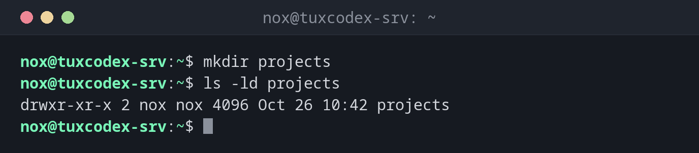

# mkdir

> Creates new directories, including all missing parent directories if needed.

## Syntax

```bash
mkdir [OPTION]... DIRECTORY...
```

## Options

| Option | Description |
|--------|-------------|
| `-p`, `--parents` | Also create missing parent directories, no error if the directory exists |
| `-m`, `--mode=MODE` | Set the permissions right away (e.g. `700`) |
| `-v`, `--verbose` | Print a message for every created directory |

## Examples

**Create a directory:**

```bash
mkdir projects
ls -ld projects
```

```text
drwxr-xr-x 2 nox nox 4096 Oct 26 10:42 projects
```

**Create a nested directory structure in one go:**

```bash
sudo mkdir -p /srv/www/example.com/{public,logs}
tree /srv/www
```

```text
/srv/www
└── example.com
    ├── logs
    └── public

3 directories, 0 files
```

**Show which directories were created:**

```bash
mkdir -pv backup/2026/10
```

```text
mkdir: created directory 'backup/2026'
mkdir: created directory 'backup/2026/10'
```

`backup` already existed, so only the two missing levels were created.

**Create a directory that only you can access:**

```bash
mkdir -m 700 private
ls -ld private
```

```text
drwx------ 2 nox nox 4096 Oct 26 10:42 private
```

**Create a directory that already exists:**

```bash
mkdir projects
```

```text
mkdir: cannot create directory ‘projects’: File exists
```



## When do I need it?

- To set up the directory structure for a new website, application or backup target
- In scripts and deployments, where `mkdir -p` makes sure a directory exists without
  failing if it is already there
- To create directories with restricted permissions for keys or credentials (`-m 700`)

!!! tip "`-p` in scripts"
    `mkdir -p` never fails because a directory already exists. That makes it safe to run
    a script several times.

!!! warning "Permissions outside your home directory"
    Directories like `/srv`, `/opt` or `/etc` belong to `root`. Without `sudo`, you get
    `mkdir: cannot create directory ‘/srv/www’: Permission denied`.

## Related commands

[touch](touch.md) · [cd](../02-navigation/cd.md) · [tree](../02-navigation/tree.md) · [rmdir](rmdir.md)
