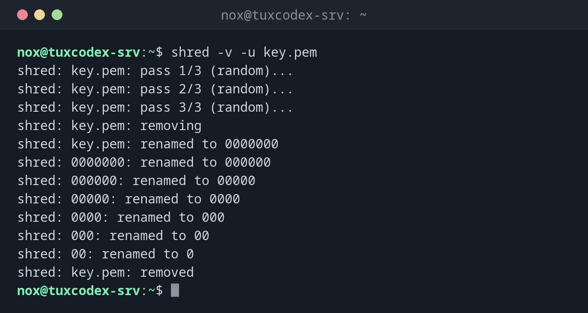

# shred

> Überschreibt eine Datei mehrfach mit Zufallsdaten, damit sich ihr Inhalt nicht wiederherstellen lässt, und löscht sie auf Wunsch.



## Syntax

```bash
shred [OPTION]... DATEI...
```

## Optionen

| Option | Beschreibung |
|--------|--------------|
| `-u`, `--remove` | Datei nach dem Überschreiben löschen |
| `-n`, `--iterations=N` | `N`-mal statt dreimal überschreiben |
| `-z`, `--zero` | Am Ende mit Nullen überschreiben, damit das Schreddern nicht auffällt |
| `-v`, `--verbose` | Fortschritt anzeigen |
| `-x`, `--exact` | Größe nicht auf den nächsten vollen Block aufrunden |
| `-f`, `--force` | Rechte bei Bedarf ändern, um Schreiben zu erlauben |

## Beispiele

**Eine Datei überschreiben und löschen:**

```bash
shred -v -u key.pem
```

```text
shred: key.pem: pass 1/3 (random)...
shred: key.pem: pass 2/3 (random)...
shred: key.pem: pass 3/3 (random)...
shred: key.pem: removing
shred: key.pem: renamed to 0000000
shred: 0000000: renamed to 000000
shred: 000000: renamed to 00000
shred: 00000: renamed to 0000
shred: 0000: renamed to 000
shred: 000: renamed to 00
shred: 00: renamed to 0
shred: key.pem: removed
```

Vor dem Löschen benennt `shred` die Datei mehrmals um, damit sich auch der Name nicht
wiederherstellen lässt.

**Einmal mit Zufallsdaten und danach mit Nullen überschreiben:**

```bash
shred -v -n 1 -z old-key.pem
```

```text
shred: old-key.pem: pass 1/2 (random)...
shred: old-key.pem: pass 2/2 (000000)...
```

**Mehrere Dateien auf einmal überschreiben und löschen:**

```bash
shred -u backup/*.sql
ls backup/*.sql
```

```text
ls: cannot access 'backup/*.sql': No such file or directory
```

## Wann brauche ich das?

- Um alte private Schlüssel, Zertifikate oder Dateien mit Passwörtern zu vernichten
- Um Datenbank-Dumps oder Exporte mit personenbezogenen Daten zu löschen, bevor ein
  Server übergeben wird
- Bevor eine Festplatte zurückgegeben oder verkauft wird (dann für das ganze Gerät,
  siehe unten)

!!! tip "Die Datei wird größer"
    Ohne `-x` rundet `shred` die Dateigröße auf einen vollen Block auf (meist 4 KB). Eine
    100-Byte-Datei ist nach `shred` 4096 Bytes groß. Mit `-u` spielt das keine Rolle.

!!! warning "Nicht auf jedem Speicher zuverlässig"
    `shred` geht davon aus, dass Daten an Ort und Stelle überschrieben werden. Das ist
    **nicht** der Fall bei SSDs (Wear Leveling), Copy-on-Write-Dateisystemen wie Btrfs
    oder ZFS, RAID-Controllern mit Cache, Snapshots und Backups. Dort können alte Kopien
    der Daten übrig bleiben. Für SSDs nimm die Secure-Erase-Funktion des Laufwerks oder
    von Anfang an eine vollständige Verschlüsselung.

!!! danger "`shred` auf Geräten"
    `shred` kann auch ganze Festplatten überschreiben, z. B. `sudo shred -v -n 1 /dev/sdb`.
    Ein falscher Gerätename zerstört ohne Nachfrage die Daten auf der falschen Platte.
    Prüfe den Namen vorher mehrmals mit `lsblk`.

## Verwandte Befehle

[rm](rm.md) · [truncate](truncate.md)
