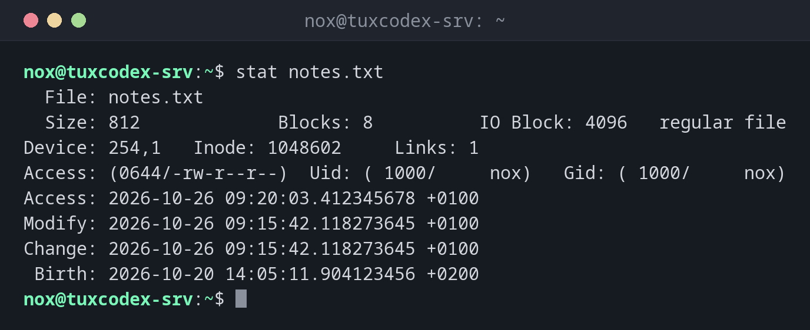

# stat

> Shows all metadata of a file: size, permissions, owner, inode and all timestamps.

## Syntax

```bash
stat [OPTION]... FILE...
```

## Options

| Option | Description |
|--------|-------------|
| `-c`, `--format=FORMAT` | Only print the given fields (see below) |
| `-f`, `--file-system` | Show information about the file system instead of the file |
| `-L`, `--dereference` | Follow symbolic links and show the target |

The most important format fields for `-c`:

| Field | Meaning | Example |
|-------|---------|---------|
| `%n` | File name | `notes.txt` |
| `%s` | Size in bytes | `812` |
| `%a` | Permissions in octal | `644` |
| `%A` | Permissions as text | `-rw-r--r--` |
| `%U` / `%G` | Owner / group | `nox` / `nox` |
| `%y` | Time of the last change | `2026-10-26 09:15:42.118273645 +0100` |
| `%i` | Inode number | `1048602` |

## Examples

**Show all information about a file:**

```bash
stat notes.txt
```

```text
  File: notes.txt
  Size: 812             Blocks: 8          IO Block: 4096   regular file
Device: 254,1   Inode: 1048602     Links: 1
Access: (0644/-rw-r--r--)  Uid: ( 1000/     nox)   Gid: ( 1000/     nox)
Access: 2026-10-26 09:20:03.412345678 +0100
Modify: 2026-10-26 09:15:42.118273645 +0100
Change: 2026-10-26 09:15:42.118273645 +0100
 Birth: 2026-10-20 14:05:11.904123456 +0200
```

| Time | Meaning |
|------|---------|
| `Access` | Last time the content was read |
| `Modify` | Last time the content was changed |
| `Change` | Last time the content **or** the metadata (permissions, owner) was changed |
| `Birth` | Time the file was created |

**Show permissions and owner in one line:**

```bash
stat -c '%a %U:%G %n' /etc/ssh/sshd_config
```

```text
644 root:root /etc/ssh/sshd_config
```

**Show only the size in bytes:**

```bash
stat -c '%s' notes.txt
```

```text
812
```

**Show the time of the last change:**

```bash
stat -c '%y' notes.txt
```

```text
2026-10-26 09:15:42.118273645 +0100
```

**Show information about the file system:**

```bash
stat -f /
```

```text
  File: /
    ID: 3f8a1c2b9d4e5f60 Namelen: 255     Type: ext2/ext3
Block size: 4096       Fundamental block size: 4096
Blocks: Total: 5127839    Free: 3912044    Available: 3647812
Inodes: Total: 1310720    Free: 1201833
```



## When do I need it?

- To find out exactly when a configuration file was last changed, down to the second
- To check permissions as a number (`644`, `600`), which is easier to compare than
  `-rw-r--r--`
- In scripts that need the size, owner or age of a file
- To check whether metadata was changed: if `Change` is newer than `Modify`, someone
  changed permissions or owner, not the content

!!! tip "Permissions for `chmod`"
    `stat -c '%a' FILE` prints the permissions in exactly the format you need for
    `chmod`. That makes it easy to copy permissions from one file to another.

!!! warning "Access time is not always exact"
    To save disk writes, Linux usually mounts file systems with `relatime`. The access
    time is then only updated in certain cases. Don't use it to prove when a file was
    last read.

## Related commands

[ls](../02-navigation/ls.md) · [touch](touch.md)
