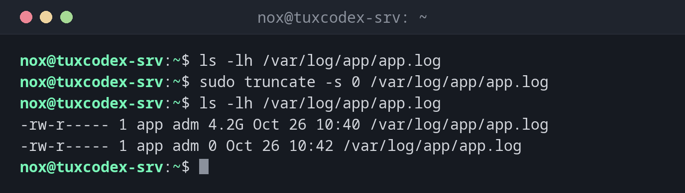

# truncate

> Bringt eine Datei auf eine exakte Größe: leert, kürzt oder vergrößert sie, ohne sie zu löschen.



## Syntax

```bash
truncate [OPTION]... -s GRÖSSE DATEI...
```

## Optionen

| Option | Beschreibung |
|--------|--------------|
| `-s`, `--size=GRÖSSE` | Neue Größe: `0` leer, `100M` genau 100 MB, `+1G` 1 GB größer, `-10K` 10 KB kleiner |
| `-c`, `--no-create` | Nicht vorhandene Dateien nicht anlegen |
| `-r`, `--reference=DATEI` | Die Größe von `DATEI` übernehmen |

## Beispiele

**Eine volle Logdatei leeren, während der Dienst weiterläuft:**

```bash
ls -lh /var/log/app/app.log
sudo truncate -s 0 /var/log/app/app.log
ls -lh /var/log/app/app.log
```

```text
-rw-r----- 1 app adm 4.2G Oct 26 10:40 /var/log/app/app.log
-rw-r----- 1 app adm 0 Oct 26 10:42 /var/log/app/app.log
```

**Eine Datei bestimmter Größe für Tests anlegen:**

```bash
truncate -s 1G test.img
ls -lh test.img
du -h test.img
```

```text
-rw-r--r-- 1 nox nox 1.0G Oct 26 10:42 test.img
0       test.img
```

Die Datei ist 1 GB groß, belegt aber noch keinen Platz auf der Platte (eine „Sparse-Datei“).

**Eine Datei auf eine feste Größe kürzen:**

```bash
truncate -s 100 notes.txt
stat -c '%s' notes.txt
```

```text
100
```

**Eine Datei vergrößern:**

```bash
truncate -s +1G test.img
ls -lh test.img
```

```text
-rw-r--r-- 1 nox nox 2.0G Oct 26 10:42 test.img
```

## Wann brauche ich das?

- Wenn eine Logdatei die Platte gefüllt hat und der Dienst weiterlaufen muss
- Um große Testdateien sofort anzulegen, etwa um Quotas oder Uploads zu testen
- Um die Image-Datei einer virtuellen Festplatte anzulegen oder zu vergrößern

!!! tip "Die Kurzform `: >`"
    `: > /var/log/app/app.log` leert eine Datei ebenfalls. Mit `sudo` nimmst du aber
    `truncate`, denn die Umleitung `>` erledigt deine eigene Shell, nicht `sudo`.

!!! warning "Warum nicht einfach `rm`?"
    Löschst du eine Logdatei mit `rm`, während ein Dienst sie noch offen hat, wird der
    Platz **nicht** frei. Der Dienst schreibt weiter in die gelöschte Datei, bis er neu
    gestartet wird. `truncate -s 0` leert die Datei an Ort und Stelle und gibt den Platz
    sofort frei.

!!! danger "Der Inhalt ist verloren"
    `truncate` schneidet Daten ohne Nachfrage ab. Brauchst du das Log noch, kopiere oder
    komprimiere es vorher: `cp app.log app.log.1 && truncate -s 0 app.log`.

## Verwandte Befehle

[rm](rm.md) · [stat](stat.md)
