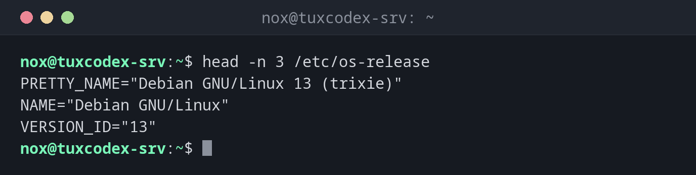

# head

> Zeigt die ersten Zeilen einer Datei, standardmäßig die ersten 10.



## Syntax

```bash
head [OPTION]... [DATEI]...
```

## Optionen

| Option | Beschreibung |
|--------|--------------|
| `-n N`, `--lines=N` | Die ersten `N` statt 10 Zeilen zeigen |
| `-n -N` | Alles außer den letzten `N` Zeilen zeigen |
| `-c N`, `--bytes=N` | Die ersten `N` Bytes zeigen |
| `-q`, `--quiet` | Bei mehreren Dateien keine Dateinamen ausgeben |
| `-v`, `--verbose` | Immer den Dateinamen ausgeben |

## Beispiele

**Die ersten Zeilen einer Datei anzeigen:**

```bash
head -n 3 /etc/os-release
```

```text
PRETTY_NAME="Debian GNU/Linux 13 (trixie)"
NAME="Debian GNU/Linux"
VERSION_ID="13"
```

**Die ältesten Einträge eines Logs anzeigen:**

```bash
head -n 2 /var/log/nginx/access.log
```

```text
192.0.2.10 - - [26/Oct/2026:09:12:03 +0100] "GET / HTTP/1.1" 200 6512 "-" "Mozilla/5.0"
192.0.2.10 - - [26/Oct/2026:09:12:03 +0100] "GET /style.css HTTP/1.1" 200 1840 "-" "Mozilla/5.0"
```

**Den Anfang mehrerer Dateien ansehen:**

```bash
head -n 1 /etc/hostname /etc/os-release
```

```text
==> /etc/hostname <==
tuxcodex-srv

==> /etc/os-release <==
PRETTY_NAME="Debian GNU/Linux 13 (trixie)"
```

**Alles außer der letzten Zeile anzeigen:**

```bash
head -n -1 deploy.log
```

```text
2026-10-26 10:40:01 deploy started
2026-10-26 10:40:12 files copied
```

**Die neueste Datei in einem Verzeichnis finden:**

```bash
ls -t backup | head -n 1
```

```text
db-2026-10-20.sql.gz
```

## Wann brauche ich das?

- Um zu prüfen, wie eine Datei aussieht, bevor du sie öffnest oder verarbeitest, etwa
  die Spaltenüberschriften eines CSV-Exports
- Um zu sehen, wo ein Log beginnt, zum Beispiel wie weit es zurückreicht
- Zusammen mit anderen Befehlen: `ls -t | head -n 1` für die neueste Datei,
  `sort | head` für die obersten Einträge einer Liste

!!! tip "Mit `tail` für einen Bereich kombinieren"
    `head -n 20 DATEI | tail -n 5` zeigt die Zeilen 16 bis 20. So schneidest du jeden
    beliebigen Bereich aus einer Datei heraus.

!!! warning "Nicht die neuesten Logeinträge"
    Logdateien wachsen am Ende. `head` zeigt die **ältesten** Einträge. Für die neuesten
    nimm [`tail`](tail.md).

## Verwandte Befehle

[cat](cat.md) · [less](less.md) · [tail](tail.md)
