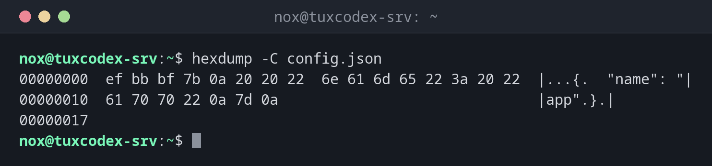

# hexdump

> Shows the bytes of a file in hexadecimal, including all characters that are invisible in a text editor.



## Syntax

```bash
hexdump [OPTION]... FILE...
```

## Options

| Option | Description |
|--------|-------------|
| `-C` | Canonical format: offset, hex bytes and readable characters side by side |
| `-n N` | Only read the first `N` bytes |
| `-s N` | Skip the first `N` bytes |
| `-v` | Show all lines, even repeated ones (otherwise shown as `*`) |

## Examples

**Find a byte order mark (BOM) in a configuration file:**

```bash
hexdump -C config.json
```

```text
00000000  ef bb bf 7b 0a 20 20 22  6e 61 6d 65 22 3a 20 22  |...{.  "name": "|
00000010  61 70 70 22 0a 7d 0a                              |app".}.|
00000017
```

The bytes `ef bb bf` at the beginning are a UTF-8 BOM. Many programs choke on it, although
an editor doesn't show it.

| Column | Meaning |
|--------|---------|
| `00000000` | Position (offset) of the first byte in the line, in hex |
| `ef bb bf 7b …` | The bytes as hexadecimal numbers, 16 per line |
| `|...{.  "name": "|` | The same bytes as characters, `.` for anything not printable |

**Find Windows line endings in a script:**

```bash
hexdump -C deploy.sh
```

```text
00000000  23 21 2f 62 69 6e 2f 62  61 73 68 0d 0a 65 63 68  |#!/bin/bash..ech|
00000010  6f 20 22 44 65 70 6c 6f  79 22 0d 0a              |o "Deploy"..|
0000001c
```

`0d 0a` is a Windows line ending (CR LF). On Linux, a line ends with `0a` only.

**Look only at the beginning of a file:**

```bash
hexdump -C -n 16 backup/db-2026-10-20.sql.gz
```

```text
00000000  1f 8b 08 08 cc 57 d7 6a  00 03 64 62 2d 32 30 32  |.....W.j..db-202|
00000010
```

`1f 8b` is the signature of every gzip file. This is how `file` recognises file types.

**A file that contains only zeros:**

```bash
hexdump -C zero.bin
```

```text
00000000  00 00 00 00 00 00 00 00  00 00 00 00 00 00 00 00  |................|
*
00000400
```

The `*` means: the previous line repeats until offset `400` (1024 bytes).

## When do I need it?

- When a configuration or script fails although it looks correct in the editor: BOM,
  Windows line endings, tabs or non-breaking spaces become visible
- To check the signature of a file (gzip, PNG, ELF) and find damaged or wrongly named files
- To check whether a disk or file really contains only zeros, for example after wiping it

!!! tip "Always use `-C`"
    Without options, `hexdump` shows the bytes in 2-byte groups in a confusing order.
    `hexdump -C` is the format everyone expects. On Debian, `hd` is a short form for it.

## Debian vs. Arch

| | Debian | Arch |
|---|--------|------|
| Package | `bsdextrautils` | `util-linux` (always installed) |
| Short form `hd` | available | not available |

If `hexdump` is missing on Debian, install it with `sudo apt install bsdextrautils`.
An alternative is `xxd` from the package of the same name.

## Related commands

[file](../03-files/file.md) · [cat](cat.md)
