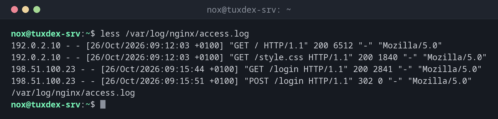

# less

> Shows files page by page, lets you scroll back and forth, search and follow a growing log live.



## Syntax

```bash
less [OPTION]... [FILE]...
```

## Options

| Option | Description |
|--------|-------------|
| `-N` | Show line numbers |
| `-S` | Cut off long lines instead of wrapping them (scroll sideways with the arrow keys) |
| `-i` | Ignore upper and lower case when searching (unless the search contains capitals) |
| `-R` | Show colours from programs correctly |
| `+F` | Start in follow mode, like `tail -f` |
| `+G` | Start at the end of the file |
| `+/PATTERN` | Start at the first match of `PATTERN` |

Keys inside `less`:

| Key | Action |
|-----|--------|
| ++space++ / ++b++ | One page forward / back |
| ++g++ / ++shift+g++ | Jump to the beginning / end |
| ++slash++ `PATTERN` | Search forward |
| ++question++ `PATTERN` | Search backward |
| ++n++ / ++shift+n++ | Next / previous match |
| ++shift+f++ | Follow mode: show new lines live, stop with ++ctrl+c++ |
| `&` `PATTERN` | Only show lines containing `PATTERN` |
| ++h++ | Help with all keys |
| ++q++ | Quit |

## Examples

**Open a log file:**

```bash
less /var/log/nginx/access.log
```

```text
192.0.2.10 - - [26/Oct/2026:09:12:03 +0100] "GET / HTTP/1.1" 200 6512 "-" "Mozilla/5.0"
192.0.2.10 - - [26/Oct/2026:09:12:03 +0100] "GET /style.css HTTP/1.1" 200 1840 "-" "Mozilla/5.0"
198.51.100.23 - - [26/Oct/2026:09:15:44 +0100] "GET /login HTTP/1.1" 200 2841 "-" "Mozilla/5.0"
198.51.100.23 - - [26/Oct/2026:09:15:51 +0100] "POST /login HTTP/1.1" 302 0 "-" "Mozilla/5.0"
/var/log/nginx/access.log
```

The bottom line shows the file name. Press ++space++ to scroll, ++q++ to quit.

**Show line numbers:**

```bash
less -N /etc/hosts
```

```text
      1 127.0.0.1       localhost
      2 127.0.1.1       tuxcodex-srv.example.com        tuxcodex-srv
      3
      4 # The following lines are desirable for IPv6 capable hosts
      5 ::1     localhost ip6-localhost ip6-loopback
      6 ff02::1 ip6-allnodes
      7 ff02::2 ip6-allrouters
/etc/hosts (END)
```

**Start directly at the first match:**

```bash
less +/' 404 ' /var/log/nginx/access.log
```

```text
198.51.100.23 - - [26/Oct/2026:10:41:12 +0100] "GET /favicon.ico HTTP/1.1" 404 153 "-" "Mozilla/5.0"
192.0.2.55 - - [26/Oct/2026:10:41:58 +0100] "GET / HTTP/1.1" 200 6512 "-" "curl/8.14.1"
(END)
```

**Follow a log live:**

```bash
less +F /var/log/nginx/error.log
```

```text
2026/10/26 10:41:12 [error] 1234#1234: *57 open() "/var/www/example.com/public/favicon.ico" failed (2: No such file or directory), client: 198.51.100.23, server: example.com, request: "GET /favicon.ico HTTP/1.1", host: "example.com"
Waiting for data... (interrupt to abort)
```

Press ++ctrl+c++ to stop following and scroll or search. Press ++shift+f++ to continue
following.

**Page through the output of another command:**

```bash
dpkg -l | less -S
```

```text
Desired=Unknown/Install/Remove/Purge/Hold
| Status=Not/Inst/Conf-files/Unpacked/halF-conf/Half-inst/trig-aWait/Trig-pend
|/ Err?=(none)/Reinst-required (Status,Err: uppercase=bad)
||/ Name                    Version                  Architecture Description
:
```

## When do I need it?

- To read long configuration files and logs without them rushing past
- To search for an error in a large log and jump between the matches
- To watch a log live (`+F`) and still be able to scroll back and search
- To page through the long output of other commands (`COMMAND | less`)

!!! tip "`less` instead of `more`"
    `more` is the older pager and can only scroll forward. `less` can do everything
    `more` can, and much more. That's where the name comes from: "less is more".

!!! tip "Filter like `grep`"
    Type `&` followed by a word inside `less`, and only the matching lines are shown.
    Type `&` and ++enter++ to show all lines again.

!!! warning "Follow mode blocks the keys"
    In follow mode (`+F` or ++shift+f++), `less` only waits for new lines. Scrolling and
    searching only work after you press ++ctrl+c++. This does not stop `less`, only the
    following.

## Related commands

[cat](cat.md) · [tac](tac.md) · [tail](tail.md) · [zless](zless.md)
