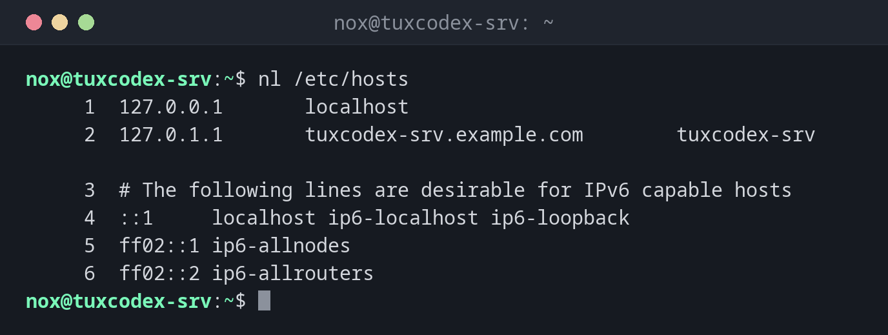

# nl

> Prints a file with line numbers, with full control over which lines are numbered and how.



## Syntax

```bash
nl [OPTION]... [FILE]...
```

## Options

| Option | Description |
|--------|-------------|
| `-b a` | Number all lines, including empty ones |
| `-b t` | Number only lines with text (default) |
| `-n ln` / `rn` / `rz` | Number format: left-aligned, right-aligned (default), right-aligned with leading zeros |
| `-w N` | Width of the line number (default `6`) |
| `-s TEXT` | Text between number and line (default a tab) |
| `-v N` | Start numbering at `N` |

## Examples

**Number all lines with text:**

```bash
nl /etc/hosts
```

```text
     1  127.0.0.1       localhost
     2  127.0.1.1       tuxcodex-srv.example.com        tuxcodex-srv

     3  # The following lines are desirable for IPv6 capable hosts
     4  ::1     localhost ip6-localhost ip6-loopback
     5  ff02::1 ip6-allnodes
     6  ff02::2 ip6-allrouters
```

Unlike `cat -n`, `nl` skips empty lines by default.

**Also number empty lines:**

```bash
nl -b a /etc/hosts
```

```text
     1  127.0.0.1       localhost
     2  127.0.1.1       tuxcodex-srv.example.com        tuxcodex-srv
     3
     4  # The following lines are desirable for IPv6 capable hosts
     5  ::1     localhost ip6-localhost ip6-loopback
     6  ff02::1 ip6-allnodes
     7  ff02::2 ip6-allrouters
```

**Choose a compact format:**

```bash
nl -w 2 -s ': ' deploy.log
```

```text
 1: 2026-10-26 10:40:01 deploy started
 2: 2026-10-26 10:40:12 files copied
 3: 2026-10-26 10:40:15 service restarted
```

**Numbers with leading zeros:**

```bash
nl -n rz -w 3 -s ' ' deploy.log
```

```text
001 2026-10-26 10:40:01 deploy started
002 2026-10-26 10:40:12 files copied
003 2026-10-26 10:40:15 service restarted
```

## When do I need it?

- When an error message names a line number, for example
  `nginx: [emerg] ... in /etc/nginx/sites-enabled/example.com:12`, and you want to find
  that line
- To refer to exact lines when you discuss a configuration with others
- To number lists or log excerpts for a report

!!! tip "Same numbers as the error message"
    Error messages count **all** lines, including empty ones. Use `nl -b a` or `cat -n`,
    so that the numbers match.

!!! tip "Line numbers in `less`"
    `less -N FILE` shows line numbers as well, and you can scroll and search at the same
    time.

## Related commands

[cat](cat.md)
