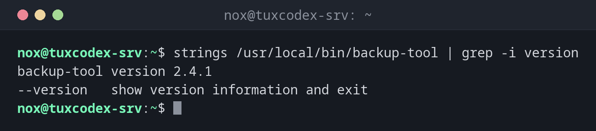

# strings

> Zieht lesbaren Text aus Binärdateien: Versionsnummern, Pfade, URLs und Meldungen.



## Syntax

```bash
strings [OPTION]... DATEI...
```

## Optionen

| Option | Beschreibung |
|--------|--------------|
| `-n N`, `--bytes=N` | Nur Zeichenketten zeigen, die mindestens `N` Zeichen lang sind (Standard `4`) |
| `-t x` / `-t d` | Position jeder Zeichenkette in der Datei zeigen, hexadezimal oder dezimal |
| `-e l` | Nach 16-Bit-Text (UTF-16) suchen, wie ihn Windows-Programme nutzen |
| `-f`, `--print-file-name` | Dateinamen vor jeder Zeichenkette ausgeben |

## Beispiele

**Die Version eines Programms herausfinden:**

```bash
strings /usr/local/bin/backup-tool | grep -i version
```

```text
backup-tool version 2.4.1
--version   show version information and exit
```

**Die Pfade finden, die ein Programm nutzt:**

```bash
strings /usr/local/bin/backup-tool | grep '^/'
```

```text
/lib64/ld-linux-x86-64.so.2
/etc/backup-tool/config.yml
/var/lib/backup-tool
/var/log/backup-tool.log
```

Jetzt weißt du, wo das Programm seine Konfiguration erwartet und wohin es sein Log schreibt.

**Nur längere Zeichenketten zeigen:**

```bash
strings -n 20 /usr/local/bin/backup-tool | head -n 3
```

```text
/etc/backup-tool/config.yml
https://updates.example.com/backup-tool/latest
error: could not connect to storage backend
```

**Anzeigen, wo in der Datei eine Zeichenkette steht:**

```bash
strings -t x /usr/local/bin/backup-tool | head -n 2
```

```text
    318 /lib64/ld-linux-x86-64.so.2
    4c1 libc.so.6
```

## Wann brauche ich das?

- Um Version, Konfigurationspfad oder Logpfad eines Programms herauszufinden, zu dem es
  keine Dokumentation gibt
- Um ein unbekanntes oder verdächtiges Binary auf URLs, IP-Adressen oder Befehle zu
  prüfen, ohne es auszuführen
- Um lesbare Meldungen in Crash-Dumps oder beschädigten Dateien zu finden

!!! tip "Mit `grep` kombinieren"
    `strings` gibt meist Hunderte Zeilen aus. Filtere die Ausgabe mit `grep` nach dem,
    was du suchst: Pfade (`'^/'`), URLs (`http`) oder Wörter wie `version` oder `error`.

!!! warning "Nicht standardmäßig installiert"
    `strings` gehört zum Paket `binutils`, das auf einem minimalen Debian-System nicht
    installiert ist. Installiere es mit:

    ```bash
    sudo apt install binutils
    ```

## Verwandte Befehle

[hexdump](hexdump.md) · [file](../03-files/file.md)
