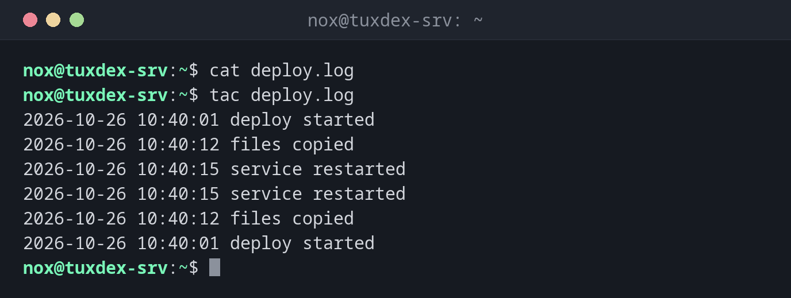

# tac

> Prints files in reverse order: the last line first.



## Syntax

```bash
tac [OPTION]... [FILE]...
```

## Options

| Option | Description |
|--------|-------------|
| `-s`, `--separator=STRING` | Use `STRING` as separator instead of a new line |
| `-b`, `--before` | Put the separator before each record instead of after it |
| `-r`, `--regex` | Treat the separator as a regular expression |

## Examples

**Show a file from the bottom up:**

```bash
cat deploy.log
tac deploy.log
```

```text
2026-10-26 10:40:01 deploy started
2026-10-26 10:40:12 files copied
2026-10-26 10:40:15 service restarted
2026-10-26 10:40:15 service restarted
2026-10-26 10:40:12 files copied
2026-10-26 10:40:01 deploy started
```

**Show the three newest entries of a log, newest first:**

```bash
tac /var/log/nginx/access.log | head -n 3
```

```text
192.0.2.55 - - [26/Oct/2026:10:41:58 +0100] "GET / HTTP/1.1" 200 6512 "-" "curl/8.14.1"
198.51.100.23 - - [26/Oct/2026:10:41:12 +0100] "GET /favicon.ico HTTP/1.1" 404 153 "-" "Mozilla/5.0"
198.51.100.23 - - [26/Oct/2026:10:41:11 +0100] "GET /login HTTP/1.1" 200 2841 "-" "Mozilla/5.0"
```

**Browse a log from the newest entry backwards:**

```bash
tac /var/log/nginx/access.log | less
```

```text
192.0.2.55 - - [26/Oct/2026:10:41:58 +0100] "GET / HTTP/1.1" 200 6512 "-" "curl/8.14.1"
198.51.100.23 - - [26/Oct/2026:10:41:12 +0100] "GET /favicon.ico HTTP/1.1" 404 153 "-" "Mozilla/5.0"
198.51.100.23 - - [26/Oct/2026:10:41:11 +0100] "GET /login HTTP/1.1" 200 2841 "-" "Mozilla/5.0"
:
```

## When do I need it?

- To read logs from the newest entry backwards, because the newest events usually
  matter most
- To find the last occurrence of something in a long file quickly
- In scripts that need to process lines in reverse order

!!! tip "Easy to remember"
    `tac` is `cat` spelled backwards, and it does exactly that: it prints a file
    backwards, line by line.

!!! tip "Reverse characters, not lines"
    `tac` reverses the order of the lines. To reverse the characters within each line,
    use `rev`.

## Related commands

[cat](cat.md) · [less](less.md)
