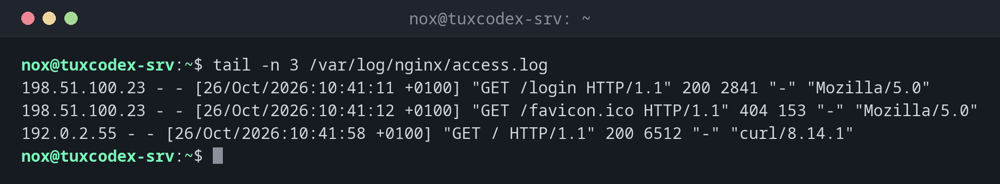

# tail

> Shows the last lines of a file, by default the last 10, and can follow new lines live.



## Syntax

```bash
tail [OPTION]... [FILE]...
```

## Options

| Option | Description |
|--------|-------------|
| `-n N`, `--lines=N` | Show the last `N` lines instead of 10 |
| `-n +N` | Show everything from line `N` on |
| `-f`, `--follow` | Keep the file open and show new lines as they are written |
| `-F` | Like `-f`, but also follow the file after log rotation |
| `-c N`, `--bytes=N` | Show the last `N` bytes |
| `--pid=PID` | Stop following when process `PID` ends |
| `-q`, `--quiet` | Don't print file names when showing several files |

## Examples

**Show the newest entries of a log:**

```bash
tail -n 3 /var/log/nginx/access.log
```

```text
198.51.100.23 - - [26/Oct/2026:10:41:11 +0100] "GET /login HTTP/1.1" 200 2841 "-" "Mozilla/5.0"
198.51.100.23 - - [26/Oct/2026:10:41:12 +0100] "GET /favicon.ico HTTP/1.1" 404 153 "-" "Mozilla/5.0"
192.0.2.55 - - [26/Oct/2026:10:41:58 +0100] "GET / HTTP/1.1" 200 6512 "-" "curl/8.14.1"
```

**Follow a log live:**

```bash
tail -f /var/log/nginx/error.log
```

```text
2026/10/26 10:41:12 [error] 1234#1234: *57 open() "/var/www/example.com/public/favicon.ico" failed (2: No such file or directory), client: 198.51.100.23, server: example.com, request: "GET /favicon.ico HTTP/1.1", host: "example.com"
```

`tail` keeps running and prints every new line immediately. Stop it with ++ctrl+c++.

**Follow two logs at the same time:**

```bash
tail -f /var/log/nginx/access.log /var/log/nginx/error.log
```

```text
==> /var/log/nginx/access.log <==
192.0.2.55 - - [26/Oct/2026:10:41:58 +0100] "GET / HTTP/1.1" 200 6512 "-" "curl/8.14.1"

==> /var/log/nginx/error.log <==
2026/10/26 10:41:12 [error] 1234#1234: *57 open() "/var/www/example.com/public/favicon.ico" failed (2: No such file or directory), client: 198.51.100.23, server: example.com, request: "GET /favicon.ico HTTP/1.1", host: "example.com"
```

**Keep following after log rotation:**

```bash
tail -F /var/log/app/access.log
```

```text
tail: '/var/log/app/access.log' has become inaccessible: No such file or directory
tail: '/var/log/app/access.log' has appeared;  following new file
```

With `-F`, `tail` notices that the file was rotated and continues with the new file.

**Skip the header line of a CSV file:**

```bash
tail -n +2 users.csv
```

```text
1,nox
2,alice
```

## When do I need it?

- To see the latest errors after something went wrong
- To watch a log live while you restart a service or test a website (`tail -f`)
- To watch several logs at the same time, for example access and error log
- To skip header lines in scripts (`tail -n +2`)

!!! tip "Test and watch at the same time"
    Open two SSH sessions: run `tail -f` on the error log in one of them and test in the
    other. You see every error the moment it happens.

!!! warning "`-f` loses the file after log rotation"
    `tail -f` follows the opened file. When `logrotate` renames it at night, `tail -f`
    keeps watching the old, renamed file and shows nothing new. For logs that are
    rotated, use `tail -F`.

## Related commands

[head](head.md) · [less](less.md)
