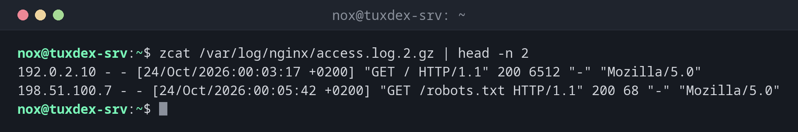

# zcat

> Gibt den Inhalt gzip-komprimierter Dateien aus, ohne sie auf der Platte zu entpacken.



## Syntax

```bash
zcat [OPTION]... [DATEI]...
```

## Optionen

| Option | Beschreibung |
|--------|--------------|
| `-f`, `--force` | Auch nicht komprimierte Dateien unverändert ausgeben |
| `-l`, `--list` | Komprimierte Größe, Originalgröße und Kompressionsrate anzeigen |
| `-t`, `--test` | Prüfen, ob die komprimierte Datei intakt ist |

## Beispiele

**Ein rotiertes Log lesen:**

```bash
zcat /var/log/nginx/access.log.2.gz | head -n 2
```

```text
192.0.2.10 - - [24/Oct/2026:00:03:17 +0200] "GET / HTTP/1.1" 200 6512 "-" "Mozilla/5.0"
198.51.100.7 - - [24/Oct/2026:00:05:42 +0200] "GET /robots.txt HTTP/1.1" 200 68 "-" "Mozilla/5.0"
```

**In einen komprimierten Datenbank-Dump schauen:**

```bash
zcat backup/db-2026-10-20.sql.gz | head -n 3
```

```text
--
-- PostgreSQL database dump
--
```

**Anzeigen, wie groß die Datei entpackt ist:**

```bash
zcat -l /var/log/nginx/access.log.2.gz
```

```text
         compressed        uncompressed  ratio uncompressed_name
               3518               28734  87.8% /var/log/nginx/access.log.2
```

**Alle rotierten Logs auf einmal lesen, komprimiert oder nicht:**

```bash
zcat -f /var/log/nginx/access.log* | wc -l
```

```text
18342
```

`-f` reicht nicht komprimierte Dateien wie `access.log` und `access.log.1` unverändert durch.

**Prüfen, ob ein Backup intakt ist:**

```bash
zcat -t backup/db-2026-10-20.sql.gz && echo OK
```

```text
OK
```

## Wann brauche ich das?

- Um ältere, rotierte Logs (`*.gz` in `/var/log`) zu lesen, ohne sie zu entpacken
- Um zu prüfen, was in einem komprimierten Backup oder Dump steckt, bevor du es
  wiederherstellst
- Um alte Logs zusammen mit `grep` zu durchsuchen oder einen Dump direkt in eine
  Datenbank zu leiten: `zcat dump.sql.gz | psql mydb`

!!! tip "Andere Kompressionsformate"
    Jedes Format hat sein eigenes `cat`: `xzcat` für `.xz`, `bzcat` für `.bz2` und
    `zstdcat` für `.zst`. Sie funktionieren genau wie `zcat`.

!!! warning "Nur für gzip-Dateien"
    Bei einer nicht komprimierten Datei bricht `zcat` mit `gzip: notes.txt: not in gzip
    format` ab. Nimm `zcat -f`, wenn eine Liste komprimierte und nicht komprimierte
    Dateien enthält.

## Verwandte Befehle

[cat](cat.md) · [less](less.md) · [zless](zless.md) · [gzip](../14-archives/gzip.md)
