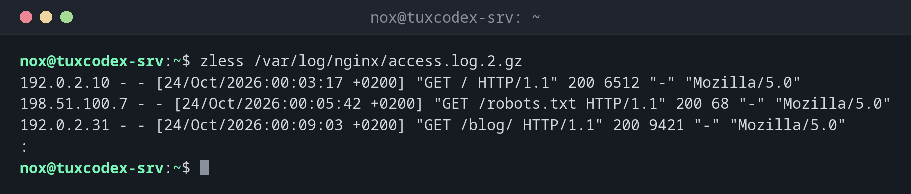

# zless

> Öffnet gzip-komprimierte Dateien in `less`, sodass du sie ohne Entpacken durchblättern und durchsuchen kannst.



## Syntax

```bash
zless [LESS_OPTION]... DATEI...
```

## Optionen

`zless` reicht alle Optionen an `less` weiter. Die nützlichsten:

| Option | Beschreibung |
|--------|--------------|
| `-N` | Zeilennummern anzeigen |
| `-S` | Lange Zeilen abschneiden statt umbrechen |
| `-i` | Bei der Suche Groß- und Kleinschreibung ignorieren |
| `+/MUSTER` | Beim ersten Treffer von `MUSTER` starten |
| `+G` | Am Ende der Datei starten |

In `zless` funktionieren alle Tasten von [`less`](less.md): ++slash++ zum Suchen, ++n++
für den nächsten Treffer, ++q++ zum Beenden.

## Beispiele

**Ein rotiertes Log durchblättern:**

```bash
zless /var/log/nginx/access.log.2.gz
```

```text
192.0.2.10 - - [24/Oct/2026:00:03:17 +0200] "GET / HTTP/1.1" 200 6512 "-" "Mozilla/5.0"
198.51.100.7 - - [24/Oct/2026:00:05:42 +0200] "GET /robots.txt HTTP/1.1" 200 68 "-" "Mozilla/5.0"
192.0.2.31 - - [24/Oct/2026:00:09:03 +0200] "GET /blog/ HTTP/1.1" 200 9421 "-" "Mozilla/5.0"
:
```

**Direkt zum ersten Serverfehler springen:**

```bash
zless +/' 500 ' /var/log/nginx/access.log.2.gz
```

```text
198.51.100.23 - - [24/Oct/2026:14:22:09 +0200] "POST /api/orders HTTP/1.1" 500 182 "-" "Mozilla/5.0"
192.0.2.10 - - [24/Oct/2026:14:22:10 +0200] "GET / HTTP/1.1" 200 6512 "-" "Mozilla/5.0"
:
```

**Am Ende eines alten Logs starten:**

```bash
zless +G /var/log/nginx/access.log.2.gz
```

```text
192.0.2.55 - - [24/Oct/2026:23:58:41 +0200] "GET / HTTP/1.1" 200 6512 "-" "curl/8.14.1"
198.51.100.23 - - [24/Oct/2026:23:59:02 +0200] "GET /login HTTP/1.1" 200 2841 "-" "Mozilla/5.0"
(END)
```

## Wann brauche ich das?

- Um ältere, rotierte Logs nach einem Fehler zu durchsuchen, der vor ein paar Tagen
  passiert ist
- Um komprimierte Backups, Dumps oder Exporte seitenweise durchzublättern
- Wenn `zcat` zu viel auf einmal ausgeben würde

!!! tip "Unter Debian kann das auch `less`"
    Debians Standard-`~/.bashrc` richtet `lesspipe` ein. In einer interaktiven Shell
    zeigt deshalb auch ein einfaches `less access.log.2.gz` den entpackten Inhalt. In
    Skripten oder anderen Shells ist `zless` der zuverlässige Weg.

!!! warning "Große komprimierte Dateien"
    `zless` entpackt die Datei während des Lesens. Der Sprung ans Ende (`G`) kann bei
    einer sehr großen Datei dauern, weil alles davor erst entpackt werden muss.

## Verwandte Befehle

[less](less.md) · [zcat](zcat.md)
