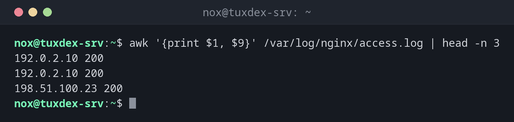

# awk

> Verarbeitet Text Spalte für Spalte: Spalten auswählen, nach Bedingungen filtern, zählen, summieren und formatieren.



## Syntax

```bash
awk [OPTION]... 'PROGRAMM' [DATEI]...
```

Ein `awk`-Programm besteht aus Blöcken der Form `BEDINGUNG { AKTION }`. Die Aktion läuft
für jede Zeile, die die Bedingung erfüllt.

## Optionen

| Option | Beschreibung |
|--------|--------------|
| `-F TRENNER` | Spaltentrenner (Standard: beliebig viele Leerzeichen und Tabs) |
| `-v NAME=WERT` | Eine Variable setzen, bevor das Programm startet |
| `-f DATEI` | Das Programm aus `DATEI` lesen |

Eingebaute Variablen und Blöcke:

| Element | Bedeutung |
|---------|-----------|
| `$1`, `$2`, … | Spalte 1, 2, … der aktuellen Zeile |
| `$0` | Die ganze Zeile |
| `$NF` | Die letzte Spalte |
| `NR` | Nummer der aktuellen Zeile |
| `NF` | Anzahl der Spalten in der aktuellen Zeile |
| `BEGIN { }` | Läuft einmal vor der ersten Zeile |
| `END { }` | Läuft einmal nach der letzten Zeile |

## Beispiele

**Bestimmte Spalten ausgeben:**

```bash
awk '{print $1, $9}' /var/log/nginx/access.log | head -n 3
```

```text
192.0.2.10 200
192.0.2.10 200
198.51.100.23 200
```

Spalte 1 ist die IP-Adresse, Spalte 9 der HTTP-Statuscode.

**Nur Zeilen zeigen, die eine Bedingung erfüllen:**

```bash
awk '$9 == 404 {print $1, $7}' /var/log/nginx/access.log
```

```text
192.0.2.77 /wp-login.php
192.0.2.77 /.env
198.51.100.23 /favicon.ico
```

**Alle normalen Benutzerkonten finden:**

```bash
awk -F: '$3 >= 1000 && $3 < 65534 {print $1}' /etc/passwd
```

```text
nox
```

Auf allen gängigen Distributionen beginnen normale Benutzer bei UID 1000. `nobody` hat die
UID 65534 und wird ausgeschlossen.

**Eine Spalte aufsummieren:**

```bash
awk '{sum += $10} END {printf "%.1f KB\n", sum/1024}' /var/log/nginx/access.log
```

```text
20.5 KB
```

Das ist die gesamte Datenmenge, die nginx für die Anfragen im Log gesendet hat.

**Werte pro Gruppe zählen:**

```bash
awk '{count[$9]++} END {for (s in count) print s, count[s]}' /var/log/nginx/access.log | sort
```

```text
200 5
302 1
404 3
```

**Die Ausgabe formatieren:**

```bash
awk -F, 'NR > 1 {printf "%-6s %s\n", $2, $3}' users.csv
```

```text
nox    nox@example.com
alice  alice@example.com
bob    bob@example.com
```

`NR > 1` überspringt die Kopfzeile, `%-6s` gibt den Namen linksbündig mit 6 Zeichen aus.

**Einen Durchschnitt berechnen:**

```bash
awk '$9 == 200 {n++; s += $10} END {print n, s/n}' /var/log/nginx/access.log
```

```text
5 4109.2
```

5 erfolgreiche Anfragen mit durchschnittlich 4109,2 Bytes.

## Wann brauche ich das?

- Um Logs auszuwerten: Anfragen pro IP, Statuscode oder URL, übertragene Daten,
  Antwortzeiten
- Um Spalten aus Ausgaben mit unregelmäßigen Leerzeichen auszuwählen, wo `cut` scheitert
- Um nach Zahlenbedingungen zu filtern, etwa Benutzer mit UID ≥ 1000 oder Dateien ab
  einer bestimmten Größe
- Für kleine Auswertungen und Summen direkt auf der Kommandozeile

!!! tip "`awk` statt `cut` bei ausgerichteter Ausgabe"
    Die Ausgabe von Befehlen wie `ps`, `df` oder `ls -l` hat mehrere Leerzeichen zwischen
    den Spalten. `awk '{print $5}'` kommt damit richtig zurecht, `cut -d' ' -f5` nicht.

!!! warning "Einfache Anführungszeichen um das Programm"
    Schreib das Programm immer in einfache Anführungszeichen: `awk '{print $1}'`. In
    doppelten Anführungszeichen ersetzt die Shell `$1` durch ihre eigene Variable, bevor
    `awk` startet, meist durch nichts.

## Unterschiede zwischen Distributionen

| | Debian | Ubuntu | RHEL | Arch |
|---|--------|--------|------|------|
| Standard-`awk` | `mawk` (schnell, Grundfunktionen) | `mawk` | `gawk` (GNU awk, viele Extras) | `gawk` |

Alle Beispiele auf dieser Seite funktionieren mit beiden. GNU-spezifische Funktionen wie
`gensub()`, `asort()` oder `PROCINFO` brauchen `gawk`. Unter Debian und Ubuntu
installierst du es mit:

```bash
sudo apt install gawk
```

## Verwandte Befehle

[cut](cut.md) · [sort](sort.md) · [uniq](uniq.md) · [jq](jq.md)
