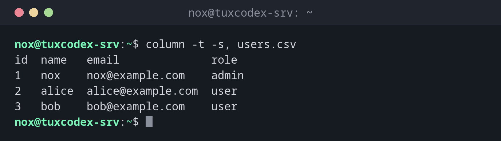

# column

> Formatiert Text in saubere, ausgerichtete Spalten, zum Beispiel eine CSV-Datei oder die Ausgabe anderer Befehle.



## Syntax

```bash
column [OPTION]... [DATEI]...
```

## Optionen

| Option | Beschreibung |
|--------|--------------|
| `-t`, `--table` | Tabelle mit ausgerichteten Spalten erzeugen |
| `-s ZEICHEN`, `--separator=ZEICHEN` | Spaltentrenner in der Eingabe (Standard: Leerzeichen) |
| `-o TEXT`, `--output-separator=TEXT` | Trenner zwischen den Spalten in der Ausgabe (Standard: zwei Leerzeichen) |
| `-N NAMEN`, `--table-columns=NAMEN` | Spalten benennen, durch Kommas getrennt |
| `-H SPALTEN`, `--table-hide=SPALTEN` | Spalten ausblenden (nach Name oder Nummer) |
| `-R SPALTEN`, `--table-right=SPALTEN` | Spalten rechtsbündig ausrichten |

## Beispiele

**Eine CSV-Datei als Tabelle anzeigen:**

```bash
column -t -s, users.csv
```

```text
id  name   email              role
1   nox    nox@example.com    admin
2   alice  alice@example.com  user
3   bob    bob@example.com    user
```

**Einen sichtbaren Spaltentrenner verwenden:**

```bash
column -t -s, -o ' | ' users.csv
```

```text
id | name  | email             | role
1  | nox   | nox@example.com   | admin
2  | alice | alice@example.com | user
3  | bob   | bob@example.com   | user
```

**`/etc/passwd` lesbar machen:**

```bash
grep -E '^(root|www-data|nox):' /etc/passwd | cut -d: -f1,3,6,7 | column -t -s:
```

```text
root      0     /root      /bin/bash
www-data  33    /var/www   /usr/sbin/nologin
nox       1000  /home/nox  /bin/bash
```

**Spaltennamen ergänzen und Spalten ausblenden:**

```bash
grep -E '^(root|www-data|nox):' /etc/passwd | column -t -s: -N USER,PW,UID,GID,GECOS,HOME,SHELL -H PW,GECOS
```

```text
USER      UID   GID   HOME       SHELL
root      0     0     /root      /bin/bash
www-data  33    33    /var/www   /usr/sbin/nologin
nox       1000  1000  /home/nox  /bin/bash
```

## Wann brauche ich das?

- Um CSV-Exporte oder durch Doppelpunkte getrennte Dateien wie `/etc/passwd` im Terminal
  zu lesen
- Um die Ausgabe eigener Skripte ordentlich aussehen zu lassen
- Um die Ausgabe von Befehlen wie `mount` oder `ss` auszurichten, deren Spalten schwer
  zu lesen sind

!!! tip "Schnelle Tabelle aus jeder Ausgabe"
    `BEFEHL | column -t` macht aus fast jeder Ausgabe mit durch Leerzeichen getrennten
    Spalten eine ausgerichtete Tabelle, zum Beispiel `mount | column -t`.

!!! warning "Breite Tabellen"
    Ist eine Tabelle breiter als das Terminal, bricht jede Zeile um, und die Ausrichtung
    geht verloren. Leite breite Tabellen in `less -S`, das lange Zeilen abschneidet statt
    sie umzubrechen.

## Debian vs. Arch

| | Debian | Arch |
|---|--------|------|
| Paket | `bsdextrautils` | `util-linux` (immer installiert) |

Fehlt `column` unter Debian, installierst du es mit `sudo apt install bsdextrautils`.

## Verwandte Befehle

[cut](cut.md) · [sort](sort.md)
