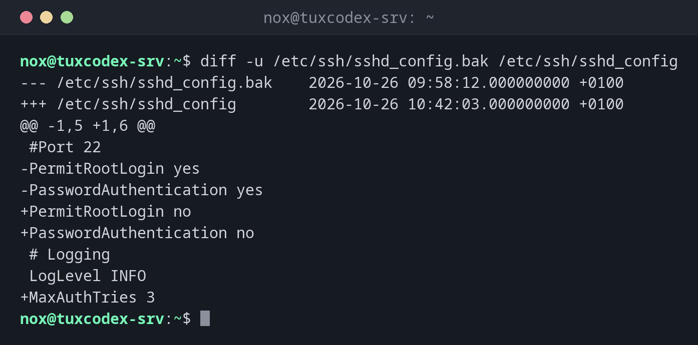

# diff

> Compares two files line by line and shows exactly what is different.



## Syntax

```bash
diff [OPTION]... FILE1 FILE2
```

## Options

| Option | Description |
|--------|-------------|
| `-u` | Unified format: changes with context, `-` removed, `+` added |
| `-y`, `--side-by-side` | Show both files side by side |
| `-q`, `--brief` | Only report whether the files differ |
| `-s` | Also report when the files are identical |
| `-r`, `--recursive` | Compare whole directories |
| `-i`, `--ignore-case` | Ignore upper and lower case |
| `-w`, `--ignore-all-space` | Ignore all spaces and tabs |
| `-B`, `--ignore-blank-lines` | Ignore empty lines |
| `--color` | Show removed lines in red and added lines in green |

## Examples

**Compare a configuration with its backup:**

```bash
diff -u /etc/ssh/sshd_config.bak /etc/ssh/sshd_config
```

```text
--- /etc/ssh/sshd_config.bak    2026-10-26 09:58:12.000000000 +0100
+++ /etc/ssh/sshd_config        2026-10-26 10:42:03.000000000 +0100
@@ -1,5 +1,6 @@
 #Port 22
-PermitRootLogin yes
-PasswordAuthentication yes
+PermitRootLogin no
+PasswordAuthentication no
 # Logging
 LogLevel INFO
+MaxAuthTries 3
```

| Line | Meaning |
|------|---------|
| `---` / `+++` | The old and the new file |
| `@@ -1,5 +1,6 @@` | Lines 1 to 5 of the old file correspond to lines 1 to 6 of the new one |
| `-` | Line was removed |
| `+` | Line was added |
| *(space)* | Unchanged line for context |

**The short default format:**

```bash
diff /etc/ssh/sshd_config.bak /etc/ssh/sshd_config
```

```text
2,3c2,3
< PermitRootLogin yes
< PasswordAuthentication yes
---
> PermitRootLogin no
> PasswordAuthentication no
5a6
> MaxAuthTries 3
```

`2,3c2,3` means: lines 2 to 3 were changed. `5a6`: after line 5, line 6 was added.

**Show both versions side by side:**

```bash
diff -y -W 60 /etc/ssh/sshd_config.bak /etc/ssh/sshd_config
```

```text
#Port 22                        #Port 22
PermitRootLogin yes          |  PermitRootLogin no
PasswordAuthentication yes   |  PasswordAuthentication no
# Logging                       # Logging
LogLevel INFO                   LogLevel INFO
                             >  MaxAuthTries 3
```

**Only check whether two files differ:**

```bash
diff -q /etc/ssh/sshd_config.bak /etc/ssh/sshd_config
```

```text
Files /etc/ssh/sshd_config.bak and /etc/ssh/sshd_config differ
```

**Compare two directories:**

```bash
diff -rq /etc/app /srv/backup/etc/app
```

```text
Files /etc/app/conf.d/app.conf and /srv/backup/etc/app/conf.d/app.conf differ
Only in /srv/backup/etc/app/conf.d: new.conf
```

**Compare the output of two commands:**

```bash
diff <(ssh web1 dpkg-query -W -f='${Package}\n') <(ssh web2 dpkg-query -W -f='${Package}\n')
```

```text
2d1
< git
3a3
> rsync
```

`git` is only installed on `web1`, `rsync` only on `web2`. `<( )` passes the output of a
command to `diff` as if it were a file.

## When do I need it?

- To check what you (or a package update) changed in a configuration file
- To compare a configuration between two servers, or with a backup
- To find out which files in a directory differ from a backup
- To create patches that someone else can apply with `patch`

!!! tip "Exit status for scripts"
    `diff` returns `0` if the files are identical, `1` if they differ and `2` on an
    error. Scripts can use this: `diff -q a b > /dev/null || echo "changed"`.

!!! tip "New configuration files after updates"
    If you changed a configuration and a package update brings a new version, the package
    manager keeps the new file next to yours (see the table below). Compare it with
    `diff -u` to see what the update would have changed.

## Distribution differences

| | Debian | Ubuntu | RHEL | Arch |
|---|--------|--------|------|------|
| New version of a changed config | `FILE.dpkg-dist`, `FILE.ucf-dist` | `FILE.dpkg-dist`, `FILE.ucf-dist` | `FILE.rpmnew` | `FILE.pacnew` |
| Your old version after replacing | `FILE.dpkg-old` | `FILE.dpkg-old` | `FILE.rpmsave` | `FILE.pacsave` |

## Related commands

[sed](sed.md) · [grep](grep.md)
