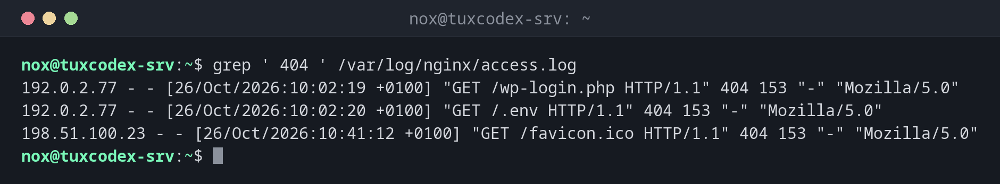

# grep

> Durchsucht Dateien oder die Ausgabe anderer Befehle nach Zeilen, die auf ein Muster passen, und zeigt nur diese Zeilen.



## Syntax

```bash
grep [OPTION]... MUSTER [DATEI]...
```

## Optionen

| Option | Beschreibung |
|--------|--------------|
| `-i`, `--ignore-case` | Groß- und Kleinschreibung ignorieren |
| `-v`, `--invert-match` | Zeilen zeigen, die **nicht** passen |
| `-c`, `--count` | Nur die Anzahl passender Zeilen ausgeben |
| `-n`, `--line-number` | Zeilennummer vor jedem Treffer zeigen |
| `-w`, `--word-regexp` | Nur ganze Wörter finden |
| `-x`, `--line-regexp` | Nur ganze Zeilen finden |
| `-o`, `--only-matching` | Nur den passenden Teil ausgeben, nicht die ganze Zeile |
| `-E`, `--extended-regexp` | Erweiterte reguläre Ausdrücke verwenden (`+`, `?`, `|`, `()`) |
| `-F`, `--fixed-strings` | Nach dem exakten Text suchen, kein regulärer Ausdruck |
| `-r`, `--recursive` | Alle Dateien in einem Verzeichnis und seinen Unterverzeichnissen durchsuchen |
| `-R`, `--dereference-recursive` | Wie `-r`, aber auch symbolischen Links folgen |
| `-l`, `--files-with-matches` | Nur die Namen der Dateien ausgeben, die einen Treffer enthalten |
| `-A N` / `-B N` / `-C N` | Zusätzlich `N` Zeilen nach / vor / um jeden Treffer zeigen |
| `-q`, `--quiet` | Nichts ausgeben, nur den Exit-Status liefern (für Skripte) |
| `--include=MUSTER` | Mit `-r`: nur Dateien durchsuchen, die auf `MUSTER` passen (z. B. `'*.conf'`) |

Die wichtigsten Bausteine regulärer Ausdrücke:

| Muster | Bedeutung | Beispiel |
|--------|-----------|----------|
| `^` | Zeilenanfang | `^#` Zeilen, die mit `#` beginnen |
| `$` | Zeilenende | `;$` Zeilen, die mit `;` enden |
| `.` | Ein beliebiges Zeichen | `h.t` passt auf `hat`, `hot` |
| `*` | Das vorherige Zeichen beliebig oft | `ab*c` passt auf `ac`, `abbc` |
| `[...]` | Eines der Zeichen in den Klammern | `[0-9]` eine Ziffer |
| `+` | Das vorherige Zeichen mindestens einmal (`-E`) | `[0-9]+` eine Zahl |
| `a|b` | `a` oder `b` (`-E`) | `error|warn` |
| `\s` | Ein Leerzeichen oder Tab | `^\s*$` leere Zeile |

## Beispiele

**Alle fehlgeschlagenen Anfragen (404) in einem Log finden:**

```bash
grep ' 404 ' /var/log/nginx/access.log
```

```text
192.0.2.77 - - [26/Oct/2026:10:02:19 +0100] "GET /wp-login.php HTTP/1.1" 404 153 "-" "Mozilla/5.0"
192.0.2.77 - - [26/Oct/2026:10:02:20 +0100] "GET /.env HTTP/1.1" 404 153 "-" "Mozilla/5.0"
198.51.100.23 - - [26/Oct/2026:10:41:12 +0100] "GET /favicon.ico HTTP/1.1" 404 153 "-" "Mozilla/5.0"
```

**Die Treffer zählen:**

```bash
grep -c ' 404 ' /var/log/nginx/access.log
```

```text
3
```

**Alles außer erfolgreichen Anfragen zeigen:**

```bash
grep -v ' 200 ' /var/log/nginx/access.log
```

```text
198.51.100.23 - - [26/Oct/2026:09:15:51 +0100] "POST /login HTTP/1.1" 302 0 "-" "Mozilla/5.0"
192.0.2.77 - - [26/Oct/2026:10:02:19 +0100] "GET /wp-login.php HTTP/1.1" 404 153 "-" "Mozilla/5.0"
192.0.2.77 - - [26/Oct/2026:10:02:20 +0100] "GET /.env HTTP/1.1" 404 153 "-" "Mozilla/5.0"
198.51.100.23 - - [26/Oct/2026:10:41:12 +0100] "GET /favicon.ico HTTP/1.1" 404 153 "-" "Mozilla/5.0"
```

**Nach mehreren Mustern gleichzeitig suchen:**

```bash
grep -E ' (302|404) ' /var/log/nginx/access.log | cut -d' ' -f1,7,9
```

```text
198.51.100.23 /login 302
192.0.2.77 /wp-login.php 404
192.0.2.77 /.env 404
198.51.100.23 /favicon.ico 404
```

**Einen Treffer zusammen mit den Zeilen drumherum zeigen:**

```bash
grep -C1 'POST' /var/log/nginx/access.log
```

```text
198.51.100.23 - - [26/Oct/2026:09:15:44 +0100] "GET /login HTTP/1.1" 200 2841 "-" "Mozilla/5.0"
198.51.100.23 - - [26/Oct/2026:09:15:51 +0100] "POST /login HTTP/1.1" 302 0 "-" "Mozilla/5.0"
192.0.2.77 - - [26/Oct/2026:10:02:19 +0100] "GET /wp-login.php HTTP/1.1" 404 153 "-" "Mozilla/5.0"
```

**Nur die IP-Adressen herausziehen:**

```bash
grep -oE '^[0-9.]+' /var/log/nginx/access.log | sort -u
```

```text
192.0.2.10
192.0.2.55
192.0.2.77
198.51.100.23
```

**Eine Konfiguration ohne Kommentare und Leerzeilen anzeigen:**

```bash
grep -vE '^\s*(#|$)' /etc/hosts
```

```text
127.0.0.1       localhost
127.0.1.1       tuxcodex-srv.example.com        tuxcodex-srv
::1     localhost ip6-localhost ip6-loopback
ff02::1 ip6-allnodes
ff02::2 ip6-allrouters
```

**Herausfinden, in welcher Konfigurationsdatei eine Einstellung steht:**

```bash
grep -rl 'example.com' /etc/nginx/
```

```text
/etc/nginx/sites-available/example.com
```

**Nach einer exakten IP-Adresse suchen:**

```bash
grep '192.0.2.1' ips.txt
grep -Fw '192.0.2.1' ips.txt
```

```text
192.0.2.1 - a
192.0.2.10 - b
192.0.2.155 - c
192.0.2.1 - a
```

In einem regulären Ausdruck steht `.` für ein beliebiges Zeichen, und `192.0.2.1` passt
auch auf `192.0.2.10`. `-F` sucht nach dem exakten Text, `-w` nur nach dem ganzen Wort.

**In einem Skript prüfen, ob etwas existiert:**

```bash
grep -q '^nox:' /etc/passwd && echo "user exists"
```

```text
user exists
```

## Wann brauche ich das?

- Um in Logs Fehler, IP-Adressen, Benutzernamen oder URLs zu finden
- Um herauszufinden, in welcher Konfigurationsdatei eine Einstellung steht (`grep -r`)
- Um die Ausgabe anderer Befehle zu filtern: `ps aux | grep nginx`,
  `dpkg -l | grep openssh`
- Um nur die aktiven Zeilen einer Konfiguration zu zeigen, ohne Kommentare
- In Skripten, um zu prüfen, ob eine Zeile, ein Benutzer oder eine Einstellung existiert
  (`grep -q`)

!!! tip "Komprimierte Logs mit `zgrep` durchsuchen"
    `zgrep` funktioniert wie `grep`, durchsucht aber auch `.gz`-Dateien:
    `zgrep ' 500 ' /var/log/nginx/access.log*` durchsucht alle rotierten Logs auf einmal.

!!! tip "Farbe und Kontext"
    Unter Debian ist `grep` in interaktiven Shells ein Alias für `grep --color=auto`, und
    der Treffer wird hervorgehoben. Zusammen mit `-C 3` siehst du jeden Treffer samt
    seinem Umfeld.

!!! warning "`-r` folgt keinen symbolischen Links"
    `grep -r` überspringt Links innerhalb des Verzeichnisses. In `/etc/nginx/sites-enabled/`
    sind alle Sites Links, deshalb findet `grep -r` dort nichts. Nimm `grep -R` oder
    durchsuche stattdessen `sites-available`.

!!! warning "Das Muster in Anführungszeichen setzen"
    Setz das Muster immer in einfache Anführungszeichen: `grep -E 'a|b'`. Ohne
    Anführungszeichen wertet die Shell Zeichen wie `|`, `*` oder `$` selbst aus, bevor
    `grep` sie zu sehen bekommt.

## Verwandte Befehle

[cut](cut.md) · [wc](wc.md) · [less](../04-viewing-files/less.md) · [sed](sed.md)
