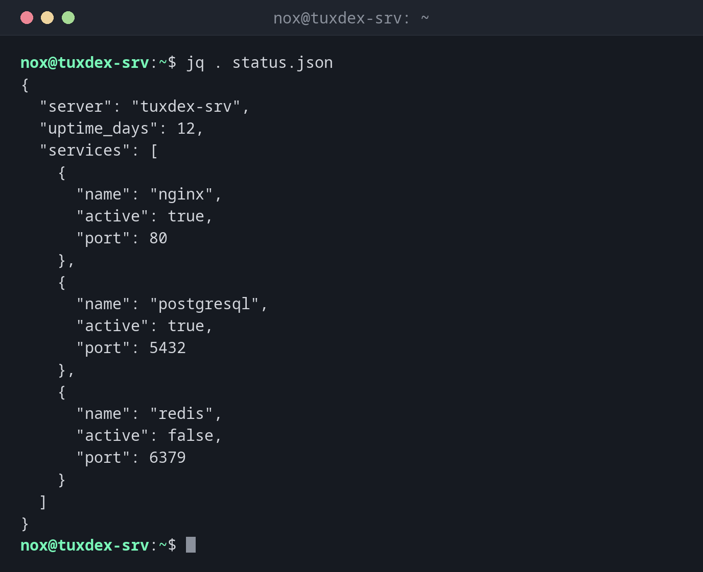

# jq

> Reads, filters and formats JSON data, for example from APIs, Docker or configuration files.



## Syntax

```bash
jq [OPTION]... FILTER [FILE]...
```

## Options

| Option | Description |
|--------|-------------|
| `-r`, `--raw-output` | Print strings without quotes (for scripts and further processing) |
| `-c`, `--compact-output` | Print each result on a single line |
| `-e`, `--exit-status` | Exit status `1` if the result is `false` or `null` |
| `--arg NAME VALUE` | Pass a shell value into the filter as `$NAME` |

The most important filters:

| Filter | Meaning |
|--------|---------|
| `.` | The whole input, nicely formatted |
| `.key` | The value of `key` |
| `.list[]` | Every element of a list |
| `.list[0]` | The first element of a list |
| `A | B` | Pass the result of `A` to `B` |
| `select(CONDITION)` | Only keep elements that meet the condition |
| `length` | Number of elements |
| `keys` | All keys of an object |
| `"\(.a): \(.b)"` | Build a text from values |

## Examples

**Format JSON readably:**

```bash
jq . status.json
```

```text
{
  "server": "tuxcodex-srv",
  "uptime_days": 12,
  "services": [
    {
      "name": "nginx",
      "active": true,
      "port": 80
    },
    {
      "name": "postgresql",
      "active": true,
      "port": 5432
    },
    {
      "name": "redis",
      "active": false,
      "port": 6379
    }
  ]
}
```

**Read a single value:**

```bash
jq -r '.server' status.json
```

```text
tuxcodex-srv
```

Without `-r`, the result would be `"tuxcodex-srv"` with quotes.

**Get a value from every element of a list:**

```bash
jq -r '.services[].name' status.json
```

```text
nginx
postgresql
redis
```

**Filter by a condition:**

```bash
jq -r '.services[] | select(.active == false) | .name' status.json
```

```text
redis
```

**Build your own output:**

```bash
jq -r '.services[] | "\(.name): \(.port)"' status.json
```

```text
nginx: 80
postgresql: 5432
redis: 6379
```

**Count elements:**

```bash
jq '.services | length' status.json
```

```text
3
```

**Find a syntax error in a JSON file:**

```bash
jq . broken.json
```

```text
jq: parse error: Expected another key-value pair at line 1, column 8
```

## When do I need it?

- To read the responses of REST APIs: `curl -s https://api.example.com/status | jq .`
- To get single values from `docker inspect`, `kubectl get -o json` or cloud CLIs
- To check JSON configuration files for syntax errors before a service loads them
- In scripts that need to react to values in JSON data

!!! tip "Check JSON before a restart"
    `jq . config.json > /dev/null && echo OK` only prints `OK` if the file is valid
    JSON. Run it before you restart a service that reads this file.

!!! warning "Not installed by default"
    `jq` is not installed by default on most distributions. The package is called `jq`
    everywhere, see the table below.

## Distribution differences

| | Debian | Ubuntu | RHEL | Arch |
|---|--------|--------|------|------|
| Install | `sudo apt install jq` | `sudo apt install jq` | `sudo dnf install jq` | `sudo pacman -S jq` |

## Related commands

[grep](grep.md) · [awk](awk.md)
