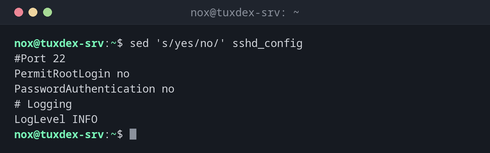

# sed

> Edits text line by line without opening an editor: search and replace, delete lines, print ranges.



## Syntax

```bash
sed [OPTION]... 'COMMAND' [FILE]...
```

## Options

| Option | Description |
|--------|-------------|
| `-i` | Change the file directly instead of printing the result |
| `-i.bak` | Like `-i`, but keep the original as `FILE.bak` |
| `-n` | Only print lines you explicitly print with `p` |
| `-E` | Use extended regular expressions (like `grep -E`) |
| `-e COMMAND` | Add a command (for several commands in one call) |

The most important `sed` commands:

| Command | Meaning |
|---------|---------|
| `s/OLD/NEW/` | Replace the first `OLD` in each line with `NEW` |
| `s/OLD/NEW/g` | Replace **all** occurrences in each line |
| `/PATTERN/d` | Delete lines matching `PATTERN` |
| `5d` / `2,4d` | Delete line 5 / lines 2 to 4 |
| `-n '2,3p'` | Only print lines 2 to 3 |
| `/PATTERN/a TEXT` | Add a line with `TEXT` after matching lines |
| `/PATTERN/i TEXT` | Insert a line with `TEXT` before matching lines |

## Examples

**Replace text in the output:**

```bash
sed 's/yes/no/' sshd_config
```

```text
#Port 22
PermitRootLogin no
PasswordAuthentication no
# Logging
LogLevel INFO
```

The file itself is not changed, `sed` only prints the result.

**Change a setting directly in the file, with a backup:**

```bash
sudo sed -i.bak 's/^PermitRootLogin yes/PermitRootLogin no/' /etc/ssh/sshd_config
grep PermitRootLogin /etc/ssh/sshd_config
```

```text
PermitRootLogin no
```

The original is kept as `/etc/ssh/sshd_config.bak`.

**Delete all comment lines:**

```bash
sed '/^#/d' sshd_config
```

```text
PermitRootLogin yes
PasswordAuthentication yes
LogLevel INFO
```

**Print only certain lines:**

```bash
sed -n '2,3p' sshd_config
```

```text
PermitRootLogin yes
PasswordAuthentication yes
```

**Cut a time window out of a log:**

```bash
sed -n '/10:02:19/,/10:41:11/p' /var/log/nginx/access.log | cut -d' ' -f4,7
```

```text
[26/Oct/2026:10:02:19 /wp-login.php
[26/Oct/2026:10:02:20 /.env
[26/Oct/2026:10:41:11 /login
```

**Add a line after a setting:**

```bash
sed '/^LogLevel/a MaxAuthTries 3' sshd_config | tail -n 2
```

```text
LogLevel INFO
MaxAuthTries 3
```

**Replace paths with a different separator:**

```bash
echo "root /var/www/old/public;" | sed 's|/var/www/old|/var/www/new|'
```

```text
root /var/www/new/public;
```

Instead of `/`, any character can be the separator. With `|`, slashes in paths don't
have to be escaped.

## When do I need it?

- To change settings in configuration files from a script or over SSH, without an editor
- To replace a domain, path or IP address in many files at once
- To remove comments, empty lines or Windows line endings (`sed -i 's/\r$//' FILE`)
- To cut a time window or a block out of a log

!!! tip "Test first, then use `-i`"
    Always run the command without `-i` first and check the output. Only when it is
    right, add `-i` (better `-i.bak`) to write the change into the file.

!!! warning "`g` for all occurrences"
    Without `g`, `s/old/new/` only replaces the **first** match in each line. Use
    `s/old/new/g` to replace all of them.

!!! danger "`sed -i` on many files"
    `sed -i 's/.../.../g' *.conf` changes all files at once, without asking and without
    an undo. A wrong pattern breaks every file. Make a backup or use `-i.bak`, and check
    the result with `diff`.

## Related commands

[grep](grep.md) · [tr](tr.md) · [awk](awk.md)
