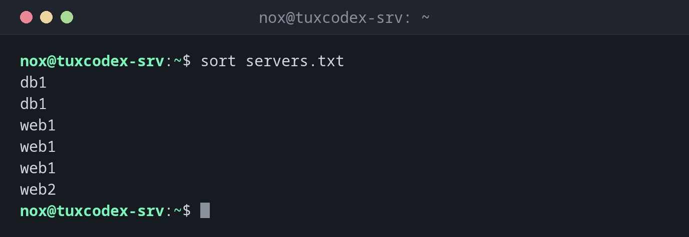

# sort

> Sorts lines alphabetically, by number, by size or by a specific column.



## Syntax

```bash
sort [OPTION]... [FILE]...
```

## Options

| Option | Description |
|--------|-------------|
| `-n`, `--numeric-sort` | Sort by number (`9` before `10`) |
| `-h`, `--human-numeric-sort` | Sort sizes like `4.0K`, `98M`, `1.2G` correctly |
| `-r`, `--reverse` | Reverse the order |
| `-u`, `--unique` | Only output each line once |
| `-t CHAR` | Use `CHAR` as column separator (default: spaces) |
| `-k N` | Sort by column `N` |
| `-f`, `--ignore-case` | Ignore upper and lower case |
| `-o FILE` | Write the result to `FILE` (may be the input file) |

## Examples

**Sort lines alphabetically:**

```bash
sort servers.txt
```

```text
db1
db1
web1
web1
web1
web2
```

**Remove duplicates while sorting:**

```bash
sort -u servers.txt
```

```text
db1
web1
web2
```

**Sort numbers correctly:**

```bash
sort ports.txt
sort -n ports.txt
```

```text
22
443
80
8080
22
80
443
8080
```

Without `-n`, `sort` compares character by character, so `443` comes before `80`. With
`-n`, the values are compared as numbers.

**Find the largest directories:**

```bash
du -sh /srv/* | sort -hr
```

```text
1.2G    /srv/backup
512M    /srv/www
98M     /srv/logs
4.0K    /srv/README
```

**Sort by a column:**

```bash
sort -t: -k3 -n /etc/passwd | cut -d: -f1,3
```

```text
root:0
daemon:1
bin:2
www-data:33
nox:1000
```

`-t:` splits the lines at `:`, `-k3 -n` sorts numerically by the third column, the user ID.

**Sort a CSV file by name, without the header line:**

```bash
tail -n +2 users.csv | sort -t, -k2
```

```text
2,alice,alice@example.com,user
3,bob,bob@example.com,user
1,nox,nox@example.com,admin
```

## When do I need it?

- To find the largest files and directories when the disk is full (`du -sh * | sort -h`)
- To prepare lists for `uniq`, which only finds duplicates that are next to each other
- To sort log entries, users or IP addresses by a column
- To compare lists, for example installed packages on two servers

!!! tip "`-u` instead of `sort | uniq`"
    `sort -u` gives the same result as `sort | uniq`, in one step.

!!! warning "The order depends on the language setting"
    With a German or English locale, `sort` mixes upper and lower case and ignores some
    special characters. Scripts that need a stable result should run `LC_ALL=C sort`.

!!! danger "`sort file > file` empties the file"
    The shell empties the target file **before** `sort` starts reading it. The result is
    an empty file. To sort a file in place, use `sort -o file file`.

## Related commands

[wc](wc.md) · [tail](../04-viewing-files/tail.md) · [uniq](uniq.md)
