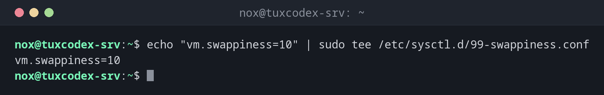

# tee

> Writes its input to one or more files and passes it on to the screen at the same time.



## Syntax

```bash
tee [OPTION]... [FILE]...
```

## Options

| Option | Description |
|--------|-------------|
| `-a`, `--append` | Append to the file instead of overwriting it |
| `-i`, `--ignore-interrupts` | Ignore ++ctrl+c++, so the file is written completely |
| `-p` | Don't stop if writing to one of the outputs fails |

## Examples

**Write a file that only `root` may change:**

```bash
echo "vm.swappiness=10" | sudo tee /etc/sysctl.d/99-swappiness.conf
```

```text
vm.swappiness=10
```

**Why the usual redirection doesn't work with `sudo`:**

```bash
sudo echo "vm.swappiness=10" > /etc/sysctl.d/99-swappiness.conf
```

```text
-bash: /etc/sysctl.d/99-swappiness.conf: Permission denied
```

`sudo` only applies to `echo`. The redirection `>` is done by your own shell, without
root rights. With `tee`, the writing itself runs with `sudo`.

**Append a line to a file:**

```bash
echo "192.0.2.20  db1.example.com  db1" | sudo tee -a /etc/hosts
```

```text
192.0.2.20  db1.example.com  db1
```

**Watch the output of a script and save it at the same time:**

```bash
./backup.sh | tee backup.log
```

```text
Backup started: 2026-10-26 10:42:01
Dumping database ... done
Compressing ... done
Backup finished: 2026-10-26 10:44:37
```

The output appears on the screen and is written to `backup.log` at the same time.

**Write without showing the output:**

```bash
echo "deb http://deb.debian.org/debian trixie-backports main" | sudo tee /etc/apt/sources.list.d/backports.list > /dev/null
cat /etc/apt/sources.list.d/backports.list
```

```text
deb http://deb.debian.org/debian trixie-backports main
```

## When do I need it?

- To write or extend configuration files with `sudo` from the command line or a script
- To save the output of long-running commands (updates, backups, migrations) while
  still watching it
- To save the raw data in the middle of a pipeline: `COMMAND | tee raw.txt | grep error`

!!! tip "Log errors as well"
    `tee` only receives standard output. To also save error messages, redirect them
    first: `./backup.sh 2>&1 | tee backup.log`.

!!! warning "Without `-a`, the file is overwritten"
    `sudo tee /etc/hosts` replaces the whole file with the new line. When you want to
    add something to an existing file, **always** use `tee -a`.

## Related commands

[cat](../04-viewing-files/cat.md) · [grep](grep.md)
