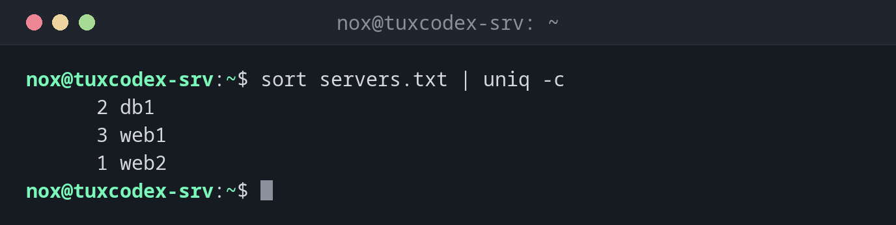

# uniq

> Entfernt oder zählt wiederholte Zeilen, die direkt aufeinanderfolgen.



## Syntax

```bash
uniq [OPTION]... [EINGABE [AUSGABE]]
```

## Optionen

| Option | Beschreibung |
|--------|--------------|
| `-c`, `--count` | Anzahl der Vorkommen vor jede Zeile setzen |
| `-d`, `--repeated` | Nur Zeilen zeigen, die mehrfach vorkommen |
| `-u`, `--unique` | Nur Zeilen zeigen, die genau einmal vorkommen |
| `-i`, `--ignore-case` | Groß- und Kleinschreibung ignorieren |
| `-f N`, `--skip-fields=N` | Die ersten `N` Felder beim Vergleich ignorieren |

## Beispiele

**Zählen, wie oft jede Zeile vorkommt:**

```bash
sort servers.txt | uniq -c
```

```text
      2 db1
      3 web1
      1 web2
```

**Die HTTP-Statuscodes in einem Log zählen:**

```bash
cut -d' ' -f9 /var/log/nginx/access.log | sort | uniq -c
```

```text
      5 200
      1 302
      3 404
```

**Die IP-Adressen mit den meisten Anfragen finden:**

```bash
cut -d' ' -f1 /var/log/nginx/access.log | sort | uniq -c | sort -rn
```

```text
      4 198.51.100.23
      2 192.0.2.77
      2 192.0.2.10
      1 192.0.2.55
```

**Nur Zeilen zeigen, die mehrfach vorkommen:**

```bash
sort servers.txt | uniq -d
```

```text
db1
web1
```

**`uniq` ohne `sort`:**

```bash
uniq servers.txt
```

```text
web1
db1
web2
web1
db1
web1
```

Nichts wurde entfernt, weil die Duplikate in der Datei nicht direkt nebeneinander stehen.

## Wann brauche ich das?

- Um zu zählen, wie oft etwas in einem Log vorkommt: IP-Adressen, Statuscodes, URLs,
  Fehlermeldungen
- Um Duplikate in Listen zu finden, etwa doppelte Einträge in einer Benutzer- oder Hostliste
- Um eine Liste auf ihre eindeutigen Einträge zu kürzen

!!! tip "Die klassische Pipeline"
    `sort | uniq -c | sort -rn` ist eine der nützlichsten Befehlsketten: Sie zählt alle
    Werte und setzt die häufigsten nach oben. Mit `| head` dahinter bekommst du eine Top 10.

!!! warning "Immer zuerst sortieren"
    `uniq` vergleicht eine Zeile nur mit der direkt davor. Duplikate, die über die Datei
    verteilt sind, findet es erst nach `sort`.

## Verwandte Befehle

[sort](sort.md) · [wc](wc.md) · [cut](cut.md)
