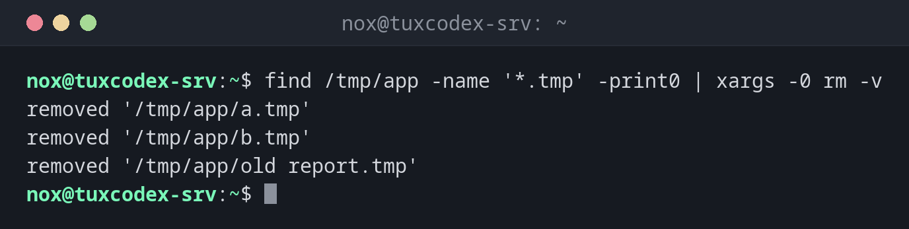

# xargs

> Turns lines of input into arguments for another command, for example to delete or copy a list of files.



## Syntax

```bash
COMMAND | xargs [OPTION]... COMMAND [ARGUMENTS]...
```

## Options

| Option | Description |
|--------|-------------|
| `-0`, `--null` | Input is separated by null characters (for `find -print0`, safe with spaces) |
| `-n N` | Pass at most `N` arguments per call |
| `-I {}` | Replace `{}` in the command with each input line (one call per line) |
| `-P N` | Run up to `N` calls in parallel |
| `-r`, `--no-run-if-empty` | Don't run the command at all if the input is empty |
| `-t`, `--verbose` | Show each command before running it |
| `-p`, `--interactive` | Ask before each call |

## Examples

**Delete files from a list, safe with spaces in names:**

```bash
find /tmp/app -name '*.tmp' -print0 | xargs -0 rm -v
```

```text
removed '/tmp/app/a.tmp'
removed '/tmp/app/b.tmp'
removed '/tmp/app/old report.tmp'
```

**The same without `-0`:**

```bash
find /tmp/app -name '*.tmp' | xargs rm -v
```

```text
removed '/tmp/app/a.tmp'
removed '/tmp/app/b.tmp'
rm: cannot remove '/tmp/app/old': No such file or directory
rm: cannot remove 'report.tmp': No such file or directory
```

Without `-0`, `xargs` splits at spaces, and `old report.tmp` becomes two wrong names.

**Run a command once for each entry:**

```bash
echo "web1 web2" | xargs -t -n 1 echo Checking
```

```text
echo Checking web1
Checking web1
echo Checking web2
Checking web2
```

`-t` shows each command before it runs.

**Place the argument anywhere in the command:**

```bash
ls *.conf | xargs -I {} cp -v {} {}.bak
```

```text
'app.conf' -> 'app.conf.bak'
'db.conf' -> 'db.conf.bak'
```

**Avoid an error when the list is empty:**

```bash
find /tmp/app -name '*.tmp' | xargs rm
find /tmp/app -name '*.tmp' | xargs -r rm
```

```text
rm: missing operand
Try 'rm --help' for more information.
```

Without `-r`, `rm` is started once even without any file. With `-r`, nothing happens.

## When do I need it?

- To process the results of `find`, `grep -l` or `ls` with another command
- To run the same command on many servers, files or users
- To speed up long tasks by running them in parallel (`-P`), for example compressing
  many log files

!!! tip "Parallel work with `-P`"
    `find /var/log/app -name '*.log' -print0 | xargs -0 -P 4 -n 1 gzip` compresses up to
    four files at the same time. On servers with several CPU cores, this is much faster.

!!! warning "Always `-print0` with `-0`"
    File names can contain spaces and even line breaks. Combine `find -print0` with
    `xargs -0`, otherwise names are split and the command hits the wrong files.

!!! danger "`xargs rm` with an unchecked list"
    Before you pipe a list into `xargs rm`, look at it: run the command without
    `| xargs rm` first, or use `xargs -p` to confirm each call.

## Related commands

[find](../02-navigation/find.md) · [grep](grep.md)
