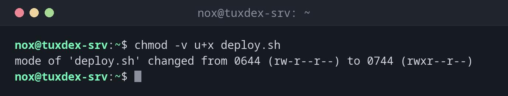

# chmod

> Changes the permissions of files and directories, as a number (`640`) or with letters (`u+x`).



## Syntax

```bash
chmod [OPTION]... MODE FILE...
```

## Options

| Option | Description |
|--------|-------------|
| `-R`, `--recursive` | Change all files and directories below as well |
| `-v`, `--verbose` | Show every change |
| `-c`, `--changes` | Only show files whose permissions really changed |
| `--reference=FILE` | Copy the permissions of `FILE` |

The `MODE` can be written in two ways:

| Form | Example | Meaning |
|------|---------|---------|
| Number | `640` | Owner `rw-`, group `r--`, others `---` |
| Letters | `u+x` | Add execute permission for the owner (`u`) |
| | `g-w` | Remove write permission for the group (`g`) |
| | `o=` | Remove all permissions for others (`o`) |
| | `a+r` | Read permission for all (`a` = `u`, `g` and `o`) |
| | `g+s` | Set the SGID bit on a directory |

## Examples

**Make a script executable:**

```bash
chmod -v u+x deploy.sh
```

```text
mode of 'deploy.sh' changed from 0644 (rw-r--r--) to 0744 (rwxr--r--)
```

**Set permissions as a number:**

```bash
chmod -v 640 /etc/app/secrets.conf
```

```text
mode of '/etc/app/secrets.conf' changed from 0644 (rw-r--r--) to 0640 (rw-r-----)
```

**Remove all rights for others:**

```bash
chmod -v o-rwx deploy.sh
```

```text
mode of 'deploy.sh' changed from 0744 (rwxr--r--) to 0740 (rwxr-----)
```

**Protect a private SSH key:**

```bash
chmod 600 ~/.ssh/id_ed25519
ls -l ~/.ssh/id_ed25519
```

```text
-rw------- 1 nox nox 411 Oct 20 14:12 /home/nox/.ssh/id_ed25519
```

**Fix the permissions of a whole website, directories and files separately:**

```bash
find /var/www/example.com -type d -exec chmod 755 {} +
find /var/www/example.com -type f -exec chmod 644 {} +
stat -c '%a %n' /var/www/example.com/public /var/www/example.com/public/index.html
```

```text
755 /var/www/example.com/public
644 /var/www/example.com/public/index.html
```

**Set up a shared directory for a group:**

```bash
sudo chmod 2775 /srv/shared
ls -ld /srv/shared
```

```text
drwxrwsr-x 2 root developers 4096 Oct 26 10:42 /srv/shared
```

The `s` in the group permissions is the SGID bit: new files in `/srv/shared`
automatically belong to the group `developers`.

## When do I need it?

- To make scripts executable
- To protect private keys, passwords and configuration files with secrets (`600`, `640`)
- To fix permissions after copying or unpacking files, for example for a website
- When SSH refuses a key with `UNPROTECTED PRIVATE KEY FILE!` because its permissions
  are too open

!!! tip "Numbers or letters?"
    Numbers set **all** permissions at once and are clear: `chmod 640` always gives the
    same result. Letters only change single permissions and leave the rest as it is,
    which is handy for `chmod +x`.

!!! warning "`chmod -R 755` makes every file executable"
    `-R` treats files and directories the same. Directories need `x`, normal files
    usually don't. Use `find -type d` and `find -type f` as shown above.

!!! danger "Never use `chmod 777`"
    `777` allows **everyone** on the server to change and replace the files. A website
    with `777` can be taken over by any process or user. If a service cannot write, give
    the right owner or group access instead (`chown`, `chgrp`).

## Related commands

[ls](../02-navigation/ls.md) · [stat](../03-files/stat.md) · [chown](chown.md) · [chgrp](chgrp.md)
