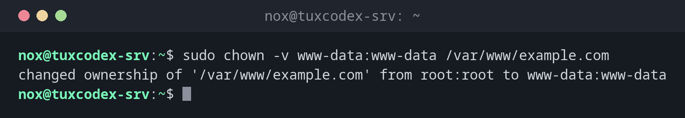

# chown

> Changes the owner and the group of files and directories.



## Syntax

```bash
chown [OPTION]... [OWNER][:[GROUP]] FILE...
```

## Options

| Option | Description |
|--------|-------------|
| `-R`, `--recursive` | Change all files and directories below as well |
| `-v`, `--verbose` | Show every change |
| `-c`, `--changes` | Only show files whose owner really changed |
| `-h`, `--no-dereference` | Change a symbolic link itself, not its target |
| `--reference=FILE` | Copy owner and group of `FILE` |

| Form | Meaning |
|------|---------|
| `nox` | Only change the owner |
| `nox:www-data` | Change owner and group |
| `:www-data` | Only change the group (like `chgrp`) |
| `nox:` | Owner `nox` and the login group of `nox` |

## Examples

**Give a website to the web server user:**

```bash
sudo chown -v www-data:www-data /var/www/example.com
```

```text
changed ownership of '/var/www/example.com' from root:root to www-data:www-data
```

**Change owner and group of a whole directory tree:**

```bash
sudo chown -R www-data:www-data /var/www/example.com
ls -l /var/www/example.com
```

```text
total 8
drwxr-xr-x 2 www-data www-data 4096 Oct 20 09:30 logs
drwxr-xr-x 4 www-data www-data 4096 Oct 20 09:30 public
```

**Only change the owner:**

```bash
sudo chown -v nox report.txt
```

```text
changed ownership of 'report.txt' from root to nox
```

**Take over files that were created with `sudo`:**

```bash
sudo chown -Rc nox: ~/projects
```

```text
changed ownership of '/home/nox/projects/app/.env' from root:root to nox:nox
changed ownership of '/home/nox/projects/app' from root:root to nox:nox
```

`-c` only lists the files that really changed.

**Try it without `sudo`:**

```bash
chown www-data /var/www/example.com/public/index.html
```

```text
chown: changing ownership of '/var/www/example.com/public/index.html': Operation not permitted
```

Only `root` may give files to another user.

## When do I need it?

- When a service cannot write its files, for example uploads or cache of a website
  (`www-data`), a database directory (`postgres`) or an application user
- After copying or unpacking files as `root`, which then belong to `root`
- When files in your home directory belong to `root` because you ran something with `sudo`

!!! tip "Owner and group in one step"
    `chown user:group` replaces a separate `chgrp`. With `user:` (colon, no group), the
    group is set to the login group of the user.

!!! warning "Only give a service what it needs"
    A web server should own only the directories it really writes to (uploads, cache).
    If it owns the whole application, an attacker who takes over the web server can
    change the code as well.

!!! danger "`chown -R` on the wrong path"
    `sudo chown -R nox / var/www` (with a space too many) changes the owner of the
    **whole system**, and the server will no longer boot correctly. Check the path
    twice before you press ++enter++.

## Related commands

[chmod](chmod.md) · [id](../01-orientation/id.md) · [chgrp](chgrp.md)
