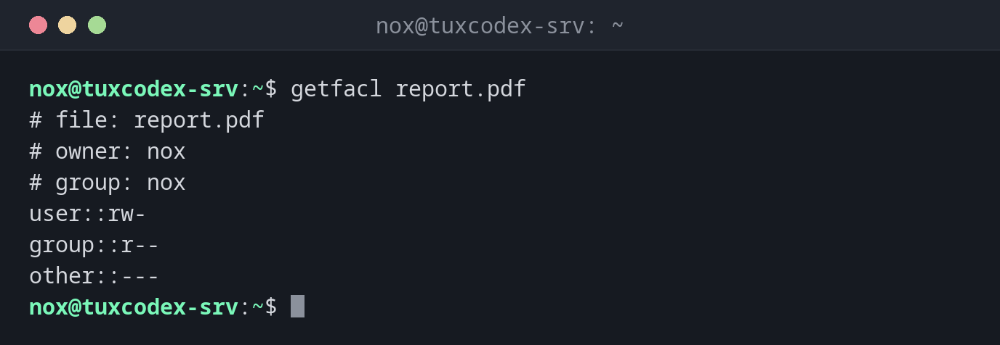

# getfacl

> Shows the access control lists (ACLs) of files and directories: additional permissions for single users and groups.



## Syntax

```bash
getfacl [OPTION]... FILE...
```

## Options

| Option | Description |
|--------|-------------|
| `-c`, `--omit-header` | Don't show the comment lines with file name, owner and group |
| `-R`, `--recursive` | Show the ACLs of all files below as well |
| `-a`, `--access` | Only show the access ACL |
| `-d`, `--default` | Only show the default ACL of a directory |
| `-p`, `--absolute-names` | Keep the leading `/` in path names |

| Entry | Meaning |
|-------|---------|
| `user::rw-` | Permissions of the owner |
| `user:alice:r--` | Additional permissions for the user `alice` |
| `group::r--` | Permissions of the owning group |
| `group:developers:rwx` | Additional permissions for the group `developers` |
| `mask::r--` | Upper limit for all additional entries and the group |
| `other::---` | Permissions for everyone else |
| `default:…` | Permissions that new files in a directory inherit |

## Examples

**Show the ACL of a file without extra entries:**

```bash
getfacl report.pdf
```

```text
# file: report.pdf
# owner: nox
# group: nox
user::rw-
group::r--
other::---
```

Without extra entries, this is the same as `ls -l` shows: `rw-r-----`.

**A file with an additional user:**

```bash
getfacl report.pdf
```

```text
# file: report.pdf
# owner: nox
# group: nox
user::rw-
user:alice:r--
group::r--
mask::r--
other::---
```

`alice` may read the file, although she is neither the owner nor in the group.

**Show the ACL of a directory with inherited permissions:**

```bash
getfacl /srv/shared
```

```text
getfacl: Removing leading '/' from absolute path names
# file: srv/shared
# owner: root
# group: root
user::rwx
group::r-x
group:developers:rwx
mask::rwx
other::---
default:user::rwx
default:group::r-x
default:group:developers:rwx
default:mask::rwx
default:other::---
```

The `default:` entries are inherited by every new file in `/srv/shared`.

**Find permissions that are limited by the mask:**

```bash
getfacl -c /srv/shared/new.txt
```

```text
user::rw-
group::r-x      #effective:r--
group:developers:rwx    #effective:rw-
mask::rw-
other::---
```

`#effective` shows what really applies: the mask `rw-` removes the `x`.

## When do I need it?

- When `ls -l` shows a `+` after the permissions (`-rw-r-----+`): there are additional ACL
  entries that `ls` doesn't show
- To find out why a user can access a file although owner, group and permissions don't
  allow it, or the other way round
- To check shared directories, where several groups have different rights

!!! tip "The `+` in `ls -l`"
    A `+` at the end of the permissions in `ls -l` is the sign that a file has ACLs.
    Only `getfacl` shows what they contain.

!!! warning "Package `acl`"
    `getfacl` and `setfacl` are in the package `acl`. If the commands are missing,
    install it with `sudo apt install acl`.

## Related commands

[chmod](chmod.md) · [ls](../02-navigation/ls.md)
