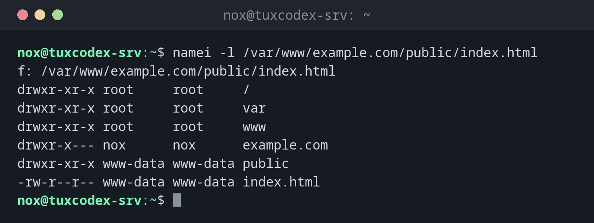

# namei

> Follows a path step by step and shows type, permissions and owner of every directory on the way.



## Syntax

```bash
namei [OPTION]... PATH...
```

## Options

| Option | Description |
|--------|-------------|
| `-l`, `--long` | Long format: permissions, owner and group (like `-m -o`) |
| `-m`, `--modes` | Show the permissions |
| `-o`, `--owners` | Show owner and group |
| `-n`, `--nosymlinks` | Don't follow symbolic links |
| `-x`, `--mountpoints` | Mark mount points with `D` |

Types in the output: `d` directory, `-` file, `l` symbolic link.

## Examples

**Find out why the web server gets "Permission denied":**

```bash
namei -l /var/www/example.com/public/index.html
```

```text
f: /var/www/example.com/public/index.html
drwxr-xr-x root     root     /
drwxr-xr-x root     root     var
drwxr-xr-x root     root     www
drwxr-x--- nox      nox      example.com
drwxr-xr-x www-data www-data public
-rw-r--r-- www-data www-data index.html
```

The file itself is readable, but `www-data` is not allowed to enter `example.com`
(`rwxr-x---`, owner and group `nox`). nginx answers with `403 Forbidden`.

**Only show the permissions:**

```bash
namei -m /etc/ssl/private/example.com.key
```

```text
f: /etc/ssl/private/example.com.key
 drwxr-xr-x /
 drwxr-xr-x etc
 drwxr-xr-x ssl
 drwx--x--- private
 -rw-r----- example.com.key
```

**Follow a symbolic link to its target:**

```bash
namei /etc/nginx/sites-enabled/example.com
```

```text
f: /etc/nginx/sites-enabled/example.com
 d /
 d etc
 d nginx
 d sites-enabled
 l example.com -> /etc/nginx/sites-available/example.com
   d /
   d etc
   d nginx
   d sites-available
   - example.com
```

**Find the part of a path that doesn't exist:**

```bash
namei -l /etc/nginx/sites-enabled/exmaple.com
```

```text
f: /etc/nginx/sites-enabled/exmaple.com
drwxr-xr-x root root /
drwxr-xr-x root root etc
drwxr-xr-x root root nginx
drwxr-xr-x root root sites-enabled
                      exmaple.com - No such file or directory
```

The typo is in the last part of the path.

## When do I need it?

- When a service reports `Permission denied` or `403 Forbidden` although the file
  permissions look right: often a directory on the way is missing the `x` permission
- To check the whole path to keys, sockets or upload directories at once
- To see where a chain of symbolic links really leads

!!! tip "Test as the service user"
    To test access directly, run a command as the user of the service:
    `sudo -u www-data cat /var/www/example.com/public/index.html`. If that fails, nginx
    can't read the file either.

!!! tip "Every directory needs `x`"
    To reach a file, a user needs the `x` permission on **every** directory of the path.
    `namei -l` shows all of them in one view.

## Related commands

[chmod](chmod.md) · [chown](chown.md) · [realpath](../02-navigation/realpath.md)
