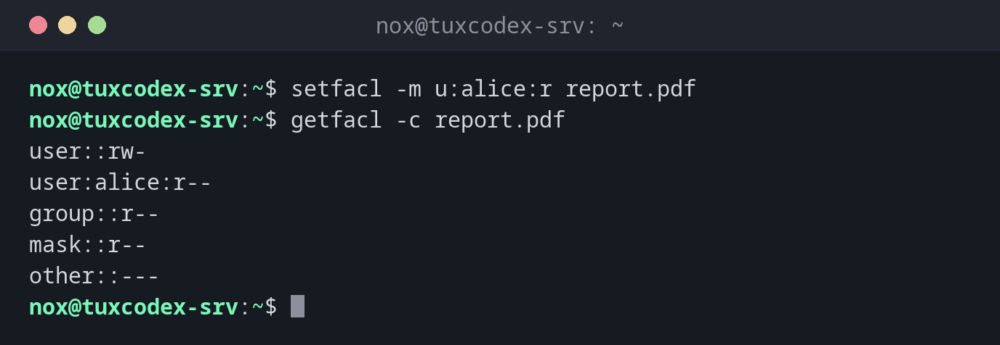

# setfacl

> Sets access control lists (ACLs): gives single users or groups permissions in addition to owner, group and others.



## Syntax

```bash
setfacl [OPTION]... ENTRY FILE...
```

## Options

| Option | Description |
|--------|-------------|
| `-m ENTRY`, `--modify` | Add or change an entry, e.g. `u:alice:r` or `g:developers:rwx` |
| `-x ENTRY`, `--remove` | Remove an entry, e.g. `u:alice` |
| `-b`, `--remove-all` | Remove all additional entries |
| `-d`, `--default` | Change the default ACL of a directory (inherited by new files) |
| `-R`, `--recursive` | Apply to all files and directories below as well |
| `-k`, `--remove-default` | Remove the default ACL |

Entries are written as `TYPE:NAME:PERMISSIONS`: `u` for a user, `g` for a group,
followed by `r`, `w` and `x`.

## Examples

**Give a single user read access:**

```bash
setfacl -m u:alice:r report.pdf
getfacl -c report.pdf
```

```text
user::rw-
user:alice:r--
group::r--
mask::r--
other::---
```

**Give a group full access to a directory:**

```bash
sudo setfacl -m g:developers:rwx /srv/shared
ls -ld /srv/shared
```

```text
drwxrwx---+ 2 root root 4096 Oct 26 10:42 /srv/shared
```

The `+` shows that the directory now has an ACL.

**Let new files inherit the permissions:**

```bash
sudo setfacl -d -m g:developers:rwx /srv/shared
getfacl -c -d /srv/shared
```

```text
user::rwx
group::r-x
group:developers:rwx
mask::rwx
other::---
```

Every file created in `/srv/shared` from now on gets the entry for `developers`.

**Give the web server read access to an existing directory tree:**

```bash
sudo setfacl -R -m u:www-data:rX /srv/app/public
getfacl -c /srv/app/public/index.html
```

```text
user::rw-
user:www-data:r--
group::r--
mask::r--
other::---
```

**Remove a single entry:**

```bash
setfacl -x u:alice report.pdf
getfacl -c report.pdf
```

```text
user::rw-
group::r--
mask::r--
other::---
```

**Remove all additional entries:**

```bash
sudo setfacl -b /srv/shared
ls -ld /srv/shared
```

```text
drwxr-x--- 2 root root 4096 Oct 26 10:42 /srv/shared
```

## When do I need it?

- When a second user or service needs access, but you don't want to change owner or
  group, for example a backup user that reads a web directory
- For shared directories where several teams need different permissions
- When new files must automatically get certain permissions (default ACL), no matter
  which `umask` the creating program uses

!!! tip "`X` instead of `x`"
    A capital `X` only gives execute permission to directories (and files that are
    already executable). `setfacl -R -m u:www-data:rX DIR` makes a tree readable without
    making every file executable.

!!! warning "`chmod` changes the mask"
    After a `chmod g-w` on a file with ACLs, the mask is reduced as well, and the extra
    entries may lose rights. `getfacl` then shows `#effective:`. Check the ACL after
    every `chmod`.

## Related commands

[getfacl](getfacl.md) · [chmod](chmod.md)
