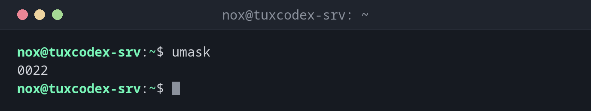

# umask

> Zeigt oder setzt, welche Rechte neue Dateien und Verzeichnisse **nicht** bekommen.



## Syntax

```bash
umask [-S] [MASKE]
```

## Optionen

| Option | Beschreibung |
|--------|--------------|
| *(keine)* | Aktuelle Maske als Zahl anzeigen |
| `-S` | Maske als erlaubte Rechte anzeigen (`u=rwx,g=rx,o=rx`) |
| `MASKE` | Neue Maske setzen, als Zahl (`027`) oder symbolisch (`u=rwx,g=rx,o=`) |

Neue Dateien starten mit `666` (`rw-rw-rw-`), neue Verzeichnisse mit `777` (`rwxrwxrwx`).
Die `umask` nimmt davon Rechte weg:

| umask | Neue Dateien | Neue Verzeichnisse | Verwendung |
|-------|--------------|--------------------|------------|
| `022` | `644` `rw-r--r--` | `755` `rwxr-xr-x` | Debian-Standard |
| `027` | `640` `rw-r-----` | `750` `rwxr-x---` | Server: andere bekommen nichts |
| `077` | `600` `rw-------` | `700` `rwx------` | Privat: nur der Besitzer |

## Beispiele

**Die aktuelle Maske anzeigen:**

```bash
umask
```

```text
0022
```

**Die Maske als Rechte anzeigen:**

```bash
umask -S
```

```text
u=rwx,g=rx,o=rx
```

**Dateien ohne Rechte für andere anlegen:**

```bash
umask 027
touch report.txt
mkdir reports
ls -ld report.txt reports
```

```text
-rw-r----- 1 nox nox    0 Oct 26 10:42 report.txt
drwxr-x--- 2 nox nox 4096 Oct 26 10:42 reports
```

**Private Dateien für eine einzelne Aufgabe anlegen:**

```bash
(umask 077; mysqldump shop > /tmp/shop.sql)
ls -l /tmp/shop.sql
```

```text
-rw------- 1 nox nox 2451873 Oct 26 10:42 /tmp/shop.sql
```

Die Klammern führen die Befehle in einer Subshell aus. Die `umask 077` gilt nur dort, und
deine Shell behält ihre normale Maske.

## Wann brauche ich das?

- Um sicherzustellen, dass neue Dateien auf einem Server nicht für jeden Benutzer lesbar
  sind (`027`)
- In Skripten, die Passwörter, Schlüssel oder Datenbank-Dumps schreiben (`077`)
- Wenn Dateien eines Dienstes mit falschen Rechten entstehen: Die `umask` des Dienstes
  entscheidet darüber

!!! tip "Dauerhaft einstellen"
    `umask` gilt nur für die aktuelle Shell. Um sie zu behalten, ergänze `umask 027` in
    deiner `~/.bashrc`. Für alle Benutzer änderst du `UMASK` in `/etc/login.defs`. Für
    einen systemd-Dienst nimmst du `UMask=0027` in seiner Unit-Datei.

!!! warning "`umask` gibt Dateien nie `x`"
    Dateien starten mit `666`, deshalb entstehen sie selbst mit `umask 000` ohne
    Ausführrecht. Skripte brauchen nach dem Anlegen trotzdem ein `chmod +x`.

## Verwandte Befehle

[chmod](chmod.md) · [touch](../03-files/touch.md) · [mkdir](../03-files/mkdir.md)
