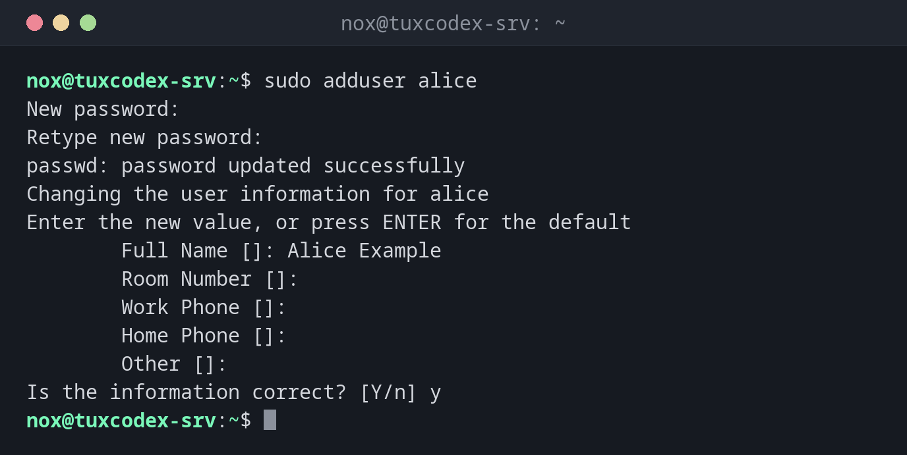

# adduser

> Creates a new user on Debian and Ubuntu step by step: home directory, group, password and contact details in one go.



## Syntax

```bash
adduser [OPTION]... USER
adduser USER GROUP
```

## Options

| Option | Description |
|--------|-------------|
| `--disabled-password` | Create the user without a password (login only with an SSH key) |
| `--disabled-login` | Create the user without any login |
| `--comment TEXT` | Full name or description, without asking |
| `--shell SHELL` | Login shell (default `/bin/bash`) |
| `--home DIR` | Home directory (default `/home/USER`) |
| `--ingroup GROUP` | Use an existing group as primary group |
| `--uid ID` | Use this UID |
| `--system` | Create a system user for a service (UID below 1000) |
| `--group` | With `--system`: also create a group of the same name |
| `--no-create-home` | Don't create a home directory |
| `--verbose` | Show every step |

## Examples

**Create a new user interactively:**

```bash
sudo adduser alice
```

```text
New password:
Retype new password:
passwd: password updated successfully
Changing the user information for alice
Enter the new value, or press ENTER for the default
        Full Name []: Alice Example
        Room Number []:
        Work Phone []:
        Home Phone []:
        Other []:
Is the information correct? [Y/n] y
```

`adduser` creates the group `alice`, the home directory `/home/alice` with the files from
`/etc/skel`, and asks for the password and contact details.

**Create a user for SSH keys only and show every step:**

```bash
sudo adduser --verbose --disabled-password --comment "Deploy User" deploy
```

```text
info: Adding user `deploy' ...
info: Selecting UID/GID from range 1000 to 59999 ...
info: Adding new group `deploy' (1002) ...
info: Adding new user `deploy' (1002) with group `deploy (1002)' ...
info: Creating home directory `/home/deploy' ...
info: Copying files from `/etc/skel' ...
info: Adding new user `deploy' to supplemental / extra groups `users' ...
info: Adding user `deploy' to group `users' ...
```

**Add an existing user to a group:**

```bash
sudo adduser alice sudo
groups alice
```

```text
alice : alice users sudo
```

**Create a system user for a service:**

```bash
sudo adduser --system --group --no-create-home --home /nonexistent myapp
getent passwd myapp
```

```text
myapp:x:105:107::/nonexistent:/usr/sbin/nologin
```

System users get a UID below 1000 and no login shell.

**Try to create a user that already exists:**

```bash
sudo adduser alice
```

```text
fatal: The user `alice' already exists.
```

## When do I need it?

- To create accounts for new admins or team members on a server
- To create a user for deployments or backups that only logs in with an SSH key
- To create a system user for your own service, so it doesn't run as `root`
- To add a user to a group, for example `sudo` or `docker`

!!! tip "`adduser` instead of `useradd` on Debian and Ubuntu"
    `adduser` creates the home directory, copies `/etc/skel` and sets a password by
    default. With `useradd`, you have to think of all that yourself. For scripts on
    several distributions, [`useradd`](useradd.md) is the portable choice.

!!! warning "New groups need a new login"
    After `adduser alice sudo`, the new group only applies to new sessions of `alice`.

## Distribution differences

| | Debian | Ubuntu | RHEL | Arch |
|---|--------|--------|------|------|
| `adduser` | interactive tool from this page | same as Debian | only another name for `useradd`, asks nothing | not available |
| Alternative | | | `useradd -m alice` and `passwd alice` | `useradd -m -G wheel alice` and `passwd alice` |

## Related commands

[groups](groups.md) · [getent](getent.md) · [useradd](useradd.md) · [deluser](deluser.md) · [addgroup](addgroup.md)
