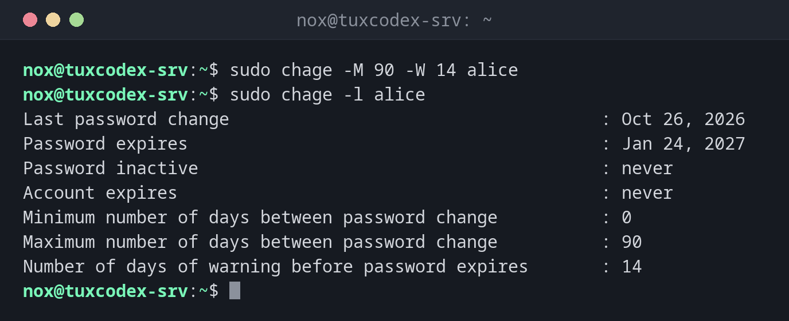

# chage

> Sets how long passwords are valid and when an account expires, and shows these settings.



## Syntax

```bash
chage [OPTION]... USER
```

## Options

| Option | Description |
|--------|-------------|
| `-l`, `--list` | Show the password and account ageing of the user |
| `-M DAYS`, `--maxdays` | The password must be changed after `DAYS` days |
| `-m DAYS`, `--mindays` | The password can be changed again after `DAYS` days at the earliest |
| `-W DAYS`, `--warndays` | Warn `DAYS` days before the password expires |
| `-E DATE`, `--expiredate` | The account expires on `DATE` (`YYYY-MM-DD`, `-1` = never) |
| `-I DAYS`, `--inactive` | Lock the account `DAYS` days after the password expired |
| `-d 0`, `--lastday 0` | Force a password change at the next login |

## Examples

**Let passwords expire after 90 days, with a warning 14 days before:**

```bash
sudo chage -M 90 -W 14 alice
sudo chage -l alice
```

```text
Last password change                                    : Oct 26, 2026
Password expires                                        : Jan 24, 2027
Password inactive                                       : never
Account expires                                         : never
Minimum number of days between password change          : 0
Maximum number of days between password change          : 90
Number of days of warning before password expires       : 14
```

**Let an account expire on a fixed date:**

```bash
sudo chage -E 2026-12-31 bob
sudo chage -l bob | grep 'Account expires'
```

```text
Account expires                                         : Dec 31, 2026
```

From January 1st, `bob` can't log in any more, not even with an SSH key.

**Force a new password at the next login:**

```bash
sudo chage -d 0 alice
sudo chage -l alice | head -n 3
```

```text
Last password change                                    : password must be changed
Password expires                                        : password must be changed
Password inactive                                       : password must be changed
```

**Remove the expiry date of an account again:**

```bash
sudo chage -E -1 bob
sudo chage -l bob | grep 'Account expires'
```

```text
Account expires                                         : never
```

## When do I need it?

- For temporary accounts of freelancers, trainees or external support, which should end
  automatically
- To implement a password policy that requires regular changes
- To find out why a user suddenly can't log in: an expired account or password is a
  common reason

!!! tip "Expiry date also stops SSH keys"
    Unlike `passwd -l`, an expired account (`chage -E`) also blocks logins with SSH
    keys. That makes it the right tool to switch off an account at a fixed date.

!!! warning "Defaults for new users"
    `chage` only changes existing users. The defaults for new users (`PASS_MAX_DAYS`,
    `PASS_WARN_AGE`) are in `/etc/login.defs`.

## Related commands

[passwd](passwd.md) · [usermod](usermod.md)
