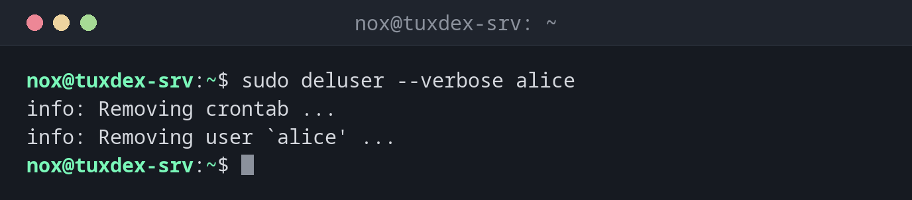

# deluser

> Deletes a user on Debian and Ubuntu, optionally with home directory, or removes a user from a group.



## Syntax

```bash
deluser [OPTION]... USER
deluser USER GROUP
```

## Options

| Option | Description |
|--------|-------------|
| `--remove-home` | Also delete the home directory and the mail spool |
| `--remove-all-files` | Delete **all** files of the user on the system |
| `--backup` | Save the files in an archive before deleting them |
| `--backup-to DIR` | Directory for the backup archive |
| `--system` | Only delete the user if it is a system user |
| `--verbose` | Show every step |

## Examples

**Delete a user, keep the home directory:**

```bash
sudo deluser --verbose alice
```

```text
info: Removing crontab ...
info: Removing user `alice' ...
```

`/home/alice` stays, so you can still save files from it.

**Delete a user together with the home directory:**

```bash
sudo deluser --verbose --remove-home bob
```

```text
info: Looking for files to backup/remove ...
info: Removing files ...
info: Removing crontab ...
info: Removing user `bob' ...
```

**Remove a user from a group:**

```bash
sudo deluser alice docker
groups alice
```

```text
alice : alice users sudo
```

The user stays, only the membership in `docker` is removed.

**Try to remove a user from their primary group:**

```bash
sudo deluser alice alice
```

```text
fatal: You may not remove the user from their primary group.
```

## When do I need it?

- When someone leaves the team and their account must be removed
- To take away access rights, for example `sudo` or `docker` (`deluser USER GROUP`)
- To clean up test or temporary accounts

!!! tip "Lock first, delete later"
    Instead of deleting an account at once, lock it with `chage -E 1 USER` and check
    for a few weeks whether anything still depends on it: cron jobs, files, services.

!!! warning "Files outside the home directory stay"
    Even with `--remove-home`, files of the user in `/srv`, `/var/www` or `/tmp` remain.
    They then belong to a UID without a name. Find them before deleting with
    `find / -xdev -user alice`.

## Distribution differences

| | Debian | Ubuntu | RHEL | Arch |
|---|--------|--------|------|------|
| `deluser` | installed | installed | not available | not available |
| Alternative | | | `userdel -r alice`, `gpasswd -d alice docker` | `userdel -r alice`, `gpasswd -d alice docker` |

## Related commands

[adduser](adduser.md) · [usermod](usermod.md) · [userdel](userdel.md) · [delgroup](delgroup.md)
